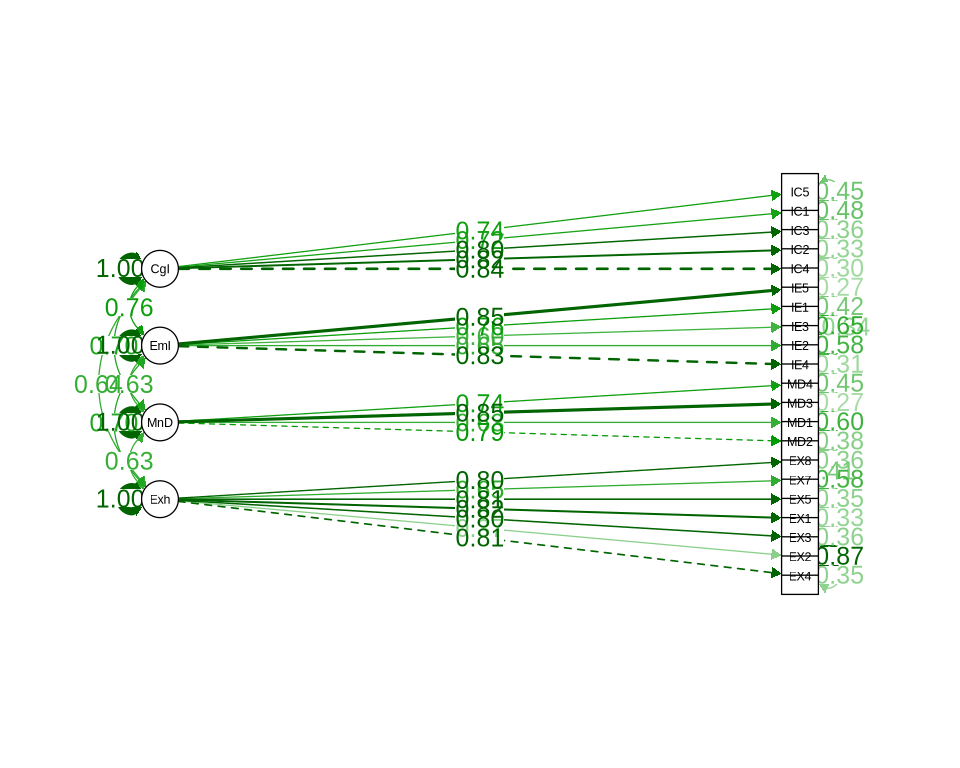

- 한국판 직무소진평가척도(K-BAT) 22문항 응답 자료로 요인 구조와 문항
  양호도 점검

- 필요한 파일: `data.xlsx` (응답자 번호 `No`, 문항 22개, `sex`, `age`)

- 하위 요인: 소진(EX, 8문항), 심리적 거리두기(MD, 4문항), 정서 손상(IE,
  5문항), 인지 손상(IC, 5문항)

- 분석 순서: 기술통계 → 요인분석 가정 확인 → 경쟁 모형 비교(1요인,
  4요인, 2차 요인) → 모형 수정 → 성별 측정 동일성 → 고전검사이론 문항
  분석

## 1. 준비

``` r
library(readxl)   # 엑셀 자료 읽기
```

``` r
library(readr)    # 결과 csv 저장
library(psych)    # 기술통계, KMO, Bartlett, Mardia, 신뢰도
```

``` r
library(lavaan)   # 확인적 요인분석
```

``` r
library(semPlot)  # 경로도
```

``` r
data <- read_excel("data.xlsx")
dim(data)  # 232명, 25개 변수
```

    ## [1] 232  25

``` r
# 분석에 쓰는 22개 문항만 별도 저장 (응답자 번호, 성별, 나이 제외)
item_cols <- c(paste0("EX", 1:8), paste0("MD", 1:4),
               paste0("IE", 1:5), paste0("IC", 1:5))
items <- as.data.frame(data[, item_cols])
```

## 2. 기술통계

``` r
describe(data)
```

<div class="kable-table">

|  | vars | n | mean | sd | median | trimmed | mad | min | max | range | skew | kurtosis | se |
|:---|---:|---:|---:|---:|---:|---:|---:|---:|---:|---:|---:|---:|---:|
| No | 1 | 232 | 116.500000 | 67.1168136 | 116.5 | 116.500000 | 85.9908 | 1 | 232 | 231 | 0.0000000 | -1.2155280 | 4.4064347 |
| EX1 | 2 | 232 | 3.077586 | 1.0823324 | 3.0 | 3.139785 | 1.4826 | 1 | 5 | 4 | -0.3164827 | -0.7287069 | 0.0710586 |
| EX2 | 3 | 232 | 3.603448 | 1.0011189 | 4.0 | 3.666667 | 1.4826 | 1 | 5 | 4 | -0.4901932 | -0.1900780 | 0.0657267 |
| EX3 | 4 | 232 | 2.818966 | 1.1365562 | 3.0 | 2.817204 | 1.4826 | 1 | 5 | 4 | 0.0922945 | -0.9080721 | 0.0746186 |
| EX4 | 5 | 232 | 3.107759 | 1.0656097 | 3.0 | 3.129032 | 1.4826 | 1 | 5 | 4 | -0.1926702 | -0.6933966 | 0.0699607 |
| EX5 | 6 | 232 | 2.844828 | 1.1365890 | 3.0 | 2.833333 | 1.4826 | 1 | 5 | 4 | 0.1637601 | -0.8733438 | 0.0746207 |
| EX6 | 7 | 232 | 2.681034 | 1.0978068 | 3.0 | 2.693548 | 1.4826 | 1 | 5 | 4 | -0.0132746 | -0.9925320 | 0.0720746 |
| EX7 | 8 | 232 | 3.090517 | 1.0952458 | 3.0 | 3.134409 | 1.4826 | 1 | 5 | 4 | -0.2572749 | -0.7541275 | 0.0719064 |
| EX8 | 9 | 232 | 3.189655 | 1.0723910 | 3.0 | 3.220430 | 1.4826 | 1 | 5 | 4 | -0.3171097 | -0.6234606 | 0.0704059 |
| MD1 | 10 | 232 | 2.517241 | 1.0359993 | 2.0 | 2.494624 | 1.4826 | 1 | 5 | 4 | 0.1983763 | -0.7342668 | 0.0680167 |
| MD2 | 11 | 232 | 2.133621 | 0.9689057 | 2.0 | 2.043011 | 1.4826 | 1 | 5 | 4 | 0.5568859 | -0.2861339 | 0.0636118 |
| MD3 | 12 | 232 | 1.974138 | 0.8969521 | 2.0 | 1.887097 | 1.4826 | 1 | 5 | 4 | 0.7312524 | 0.1560125 | 0.0588878 |
| MD4 | 13 | 232 | 2.133621 | 0.9689057 | 2.0 | 2.043011 | 1.4826 | 1 | 5 | 4 | 0.5568859 | -0.2861339 | 0.0636118 |
| IC1 | 14 | 232 | 2.232759 | 1.0349541 | 2.0 | 2.145161 | 1.4826 | 1 | 5 | 4 | 0.5532885 | -0.4813721 | 0.0679481 |
| IC2 | 15 | 232 | 2.241379 | 0.9901741 | 2.0 | 2.161290 | 1.4826 | 1 | 5 | 4 | 0.4916457 | -0.4480492 | 0.0650081 |
| IC3 | 16 | 232 | 2.094828 | 0.9667946 | 2.0 | 1.978495 | 1.4826 | 1 | 5 | 4 | 0.7840689 | 0.1969643 | 0.0634732 |
| IC4 | 17 | 232 | 2.125000 | 0.9336773 | 2.0 | 2.037634 | 1.4826 | 1 | 5 | 4 | 0.5138464 | -0.4502257 | 0.0612989 |
| IC5 | 18 | 232 | 2.254310 | 0.9489016 | 2.0 | 2.166667 | 1.4826 | 1 | 5 | 4 | 0.6583426 | 0.1716785 | 0.0622984 |
| IE1 | 19 | 232 | 1.956897 | 0.9201190 | 2.0 | 1.844086 | 1.4826 | 1 | 5 | 4 | 0.8482892 | 0.2729224 | 0.0604088 |
| IE2 | 20 | 232 | 1.788793 | 0.8129122 | 2.0 | 1.688172 | 1.4826 | 1 | 5 | 4 | 0.9300292 | 0.7073854 | 0.0533703 |
| IE3 | 21 | 232 | 2.823276 | 1.0806330 | 3.0 | 2.849462 | 1.4826 | 1 | 5 | 4 | -0.0570529 | -0.8050745 | 0.0709470 |
| IE4 | 22 | 232 | 1.943966 | 0.9940767 | 2.0 | 1.801075 | 1.4826 | 1 | 5 | 4 | 0.8486729 | -0.1218567 | 0.0652643 |
| IE5 | 23 | 232 | 2.056034 | 1.0325263 | 2.0 | 1.935484 | 1.4826 | 1 | 5 | 4 | 0.6874394 | -0.5008145 | 0.0677887 |
| sex | 24 | 232 | 1.564655 | 0.4968741 | 2.0 | 1.580645 | 0.0000 | 1 | 2 | 1 | -0.2591260 | -1.9411652 | 0.0326214 |
| age | 25 | 232 | 37.012931 | 8.2642927 | 36.0 | 36.924731 | 8.8956 | 20 | 63 | 43 | 0.1986941 | -0.4668979 | 0.5425774 |

</div>

``` r
table(data$sex)  # 1, 2: 성별 코드
```

    ## 
    ##   1   2 
    ## 101 131

## 3. 요인분석 가정 확인

``` r
KMO(items)                          # 표본 적절성 (0.8 이상이면 양호)
```

    ## Kaiser-Meyer-Olkin factor adequacy
    ## Call: KMO(r = items)
    ## Overall MSA =  0.93
    ## MSA for each item = 
    ##  EX1  EX2  EX3  EX4  EX5  EX6  EX7  EX8  MD1  MD2  MD3  MD4  IE1  IE2  IE3  IE4 
    ## 0.95 0.80 0.92 0.92 0.95 0.93 0.91 0.93 0.91 0.90 0.91 0.95 0.92 0.92 0.93 0.95 
    ##  IE5  IC1  IC2  IC3  IC4  IC5 
    ## 0.94 0.90 0.96 0.90 0.93 0.93

``` r
cortest.bartlett(cor(items), n = nrow(items))  # 상관행렬이 단위행렬과 다른지 검정
```

    ## $chisq
    ## [1] 3178.41
    ## 
    ## $p.value
    ## [1] 0
    ## 
    ## $df
    ## [1] 231

``` r
mardia(items, plot = FALSE)         # 다변량 정규성
```

    ## Call: mardia(x = items, plot = FALSE)
    ## 
    ## Mardia tests of multivariate skew and kurtosis
    ## Use describe(x) the to get univariate tests
    ## n.obs = 232   num.vars =  22 
    ## b1p =  87.95   skew =  3400.58  with probability  <=  2.5e-73
    ##  small sample skew =  3448.42  with probability <=  1.3e-77
    ## b2p =  598.91   kurtosis =  16.62  with probability <=  0

## 4. 확인적 요인분석

### 4.1. 경쟁 모형 설정

- 이론적으로 가능한 세 가지 구조 비교
- 각 요인의 첫 문항 계수를 1로 고정해 척도 설정

``` r
# (1) 1요인 모형: 22문항이 하나의 소진 요인을 측정
model_1f <- '
  Burnout =~ 1*EX4 + EX2 + EX3 + EX1 + EX5 + EX6 + EX7 + EX8 +
             MD1 + MD2 + MD3 + MD4 +
             IE1 + IE2 + IE3 + IE4 + IE5 +
             IC1 + IC2 + IC3 + IC4 + IC5
'

# (2) 4요인 모형: 하위 요인 4개, 요인 간 상관 허용 (cfa()의 기본 설정)
model_4f <- '
  Exhaustion          =~ 1*EX4 + EX2 + EX3 + EX1 + EX5 + EX6 + EX7 + EX8
  MentalDistance      =~ 1*MD2 + MD1 + MD3 + MD4
  EmotionalImpairment =~ 1*IE4 + IE2 + IE3 + IE1 + IE5
  CognitiveImpairment =~ 1*IC4 + IC2 + IC3 + IC1 + IC5
'

# (3) 2차 요인 모형: 4개 하위 요인 위에 상위 소진 요인
model_2nd <- paste(model_4f, '
  Burnout =~ Exhaustion + MentalDistance + EmotionalImpairment + CognitiveImpairment
')
```

### 4.2. 모형 추정과 비교

``` r
fit_measures <- c("chisq", "df", "rmsea", "srmr", "cfi", "tli")

fit_1f  <- cfa(model_1f,  data)
fit_4f  <- cfa(model_4f,  data)
fit_2nd <- cfa(model_2nd, data)

summary(fit_1f,  standardized = TRUE, fit.measures = TRUE)
```

    ## lavaan 0.7-2 ended normally after 26 iterations
    ## 
    ##   Estimator                                         ML
    ##   Optimization method                           NLMINB
    ##   Number of model parameters                        44
    ## 
    ##   Number of observations                           232
    ## 
    ## Model Test User Model:
    ##                                                       
    ##   Test statistic                              1037.407
    ##   Degrees of freedom                               209
    ##   P-value (Chi-square)                           0.000
    ## 
    ## Model Test Baseline Model:
    ## 
    ##   Test statistic                              3309.160
    ##   Degrees of freedom                               231
    ##   P-value                                        0.000
    ## 
    ## User Model versus Baseline Model:
    ## 
    ##   Comparative Fit Index (CFI)                    0.731
    ##   Tucker-Lewis Index (TLI)                       0.703
    ## 
    ## Loglikelihood and Information Criteria:
    ## 
    ##   Loglikelihood user model (H0)              -6141.834
    ##   Loglikelihood unrestricted model (H1)      -5623.130
    ##                                                       
    ##   Akaike (AIC)                               12371.667
    ##   Bayesian (BIC)                             12523.324
    ##   Sample-size adjusted Bayesian (SABIC)      12383.867
    ## 
    ## Root Mean Square Error of Approximation:
    ## 
    ##   RMSEA                                          0.131
    ##   90 Percent confidence interval - lower         0.123
    ##   90 Percent confidence interval - upper         0.139
    ##   P-value H_0: RMSEA <= 0.050                    0.000
    ##   P-value H_0: RMSEA >= 0.080                    1.000
    ## 
    ## Standardized Root Mean Square Residual:
    ## 
    ##   SRMR                                           0.086
    ## 
    ## Goodness of Fit Index:
    ## 
    ##   Goodness of Fit Index (GFI)                    0.680
    ##   90 Percent confidence interval - lower         0.658
    ##   90 Percent confidence interval - upper         0.701
    ## 
    ## Parameter Estimates:
    ## 
    ##   Standard errors                             Standard
    ##   Information                                 Expected
    ##   Information saturated (h1) model          Structured
    ## 
    ## Latent Variables:
    ##                    Estimate  Std.Err  z-value  P(>|z|)   Std.lv  Std.all
    ##   Burnout =~                                                            
    ##     EX4               1.000                               0.723    0.680
    ##     EX2               0.362    0.094    3.855    0.000    0.261    0.262
    ##     EX3               1.062    0.110    9.652    0.000    0.768    0.677
    ##     EX1               1.107    0.106   10.483    0.000    0.800    0.741
    ##     EX5               1.176    0.111   10.597    0.000    0.850    0.750
    ##     EX6               1.021    0.106    9.610    0.000    0.738    0.674
    ##     EX7               0.855    0.105    8.155    0.000    0.618    0.566
    ##     EX8               1.016    0.104    9.774    0.000    0.734    0.686
    ##     MD1               0.805    0.099    8.119    0.000    0.582    0.563
    ##     MD2               0.815    0.093    8.755    0.000    0.590    0.610
    ##     MD3               0.822    0.087    9.476    0.000    0.594    0.664
    ##     MD4               0.861    0.093    9.213    0.000    0.623    0.644
    ##     IE1               0.881    0.089    9.874    0.000    0.637    0.694
    ##     IE2               0.689    0.078    8.809    0.000    0.498    0.614
    ##     IE3               0.808    0.103    7.826    0.000    0.584    0.542
    ##     IE4               0.983    0.097   10.171    0.000    0.711    0.717
    ##     IE5               1.042    0.101   10.358    0.000    0.753    0.731
    ##     IC1               0.895    0.100    8.982    0.000    0.647    0.627
    ##     IC2               1.032    0.097   10.666    0.000    0.746    0.755
    ##     IC3               0.885    0.093    9.467    0.000    0.640    0.663
    ##     IC4               0.922    0.091   10.152    0.000    0.666    0.715
    ##     IC5               0.885    0.092    9.629    0.000    0.639    0.675
    ## 
    ## Variances:
    ##                    Estimate  Std.Err  z-value  P(>|z|)   Std.lv  Std.all
    ##    .EX4               0.608    0.059   10.250    0.000    0.608    0.538
    ##    .EX2               0.930    0.087   10.726    0.000    0.930    0.932
    ##    .EX3               0.697    0.068   10.258    0.000    0.697    0.542
    ##    .EX1               0.526    0.052   10.034    0.000    0.526    0.451
    ##    .EX5               0.563    0.056    9.993    0.000    0.563    0.438
    ##    .EX6               0.655    0.064   10.267    0.000    0.655    0.546
    ##    .EX7               0.812    0.077   10.486    0.000    0.812    0.680
    ##    .EX8               0.606    0.059   10.231    0.000    0.606    0.529
    ##    .MD1               0.730    0.070   10.490    0.000    0.730    0.683
    ##    .MD2               0.587    0.056   10.412    0.000    0.587    0.628
    ##    .MD3               0.448    0.044   10.294    0.000    0.448    0.559
    ##    .MD4               0.547    0.053   10.342    0.000    0.547    0.585
    ##    .IE1               0.437    0.043   10.208    0.000    0.437    0.518
    ##    .IE2               0.410    0.039   10.405    0.000    0.410    0.623
    ##    .IE3               0.822    0.078   10.519    0.000    0.822    0.707
    ##    .IE4               0.478    0.047   10.131    0.000    0.478    0.486
    ##    .IE5               0.494    0.049   10.075    0.000    0.494    0.465
    ##    .IC1               0.648    0.062   10.379    0.000    0.648    0.607
    ##    .IC2               0.420    0.042    9.967    0.000    0.420    0.430
    ##    .IC3               0.521    0.051   10.296    0.000    0.521    0.560
    ##    .IC4               0.424    0.042   10.136    0.000    0.424    0.488
    ##    .IC5               0.488    0.048   10.263    0.000    0.488    0.544
    ##     Burnout           0.523    0.090    5.783    0.000    1.000    1.000

``` r
summary(fit_4f,  standardized = TRUE, fit.measures = TRUE)
```

    ## lavaan 0.7-2 ended normally after 41 iterations
    ## 
    ##   Estimator                                         ML
    ##   Optimization method                           NLMINB
    ##   Number of model parameters                        50
    ## 
    ##   Number of observations                           232
    ## 
    ## Model Test User Model:
    ##                                                       
    ##   Test statistic                               453.487
    ##   Degrees of freedom                               203
    ##   P-value (Chi-square)                           0.000
    ## 
    ## Model Test Baseline Model:
    ## 
    ##   Test statistic                              3309.160
    ##   Degrees of freedom                               231
    ##   P-value                                        0.000
    ## 
    ## User Model versus Baseline Model:
    ## 
    ##   Comparative Fit Index (CFI)                    0.919
    ##   Tucker-Lewis Index (TLI)                       0.907
    ## 
    ## Loglikelihood and Information Criteria:
    ## 
    ##   Loglikelihood user model (H0)              -5849.874
    ##   Loglikelihood unrestricted model (H1)      -5623.130
    ##                                                       
    ##   Akaike (AIC)                               11799.747
    ##   Bayesian (BIC)                             11972.084
    ##   Sample-size adjusted Bayesian (SABIC)      11813.611
    ## 
    ## Root Mean Square Error of Approximation:
    ## 
    ##   RMSEA                                          0.073
    ##   90 Percent confidence interval - lower         0.064
    ##   90 Percent confidence interval - upper         0.082
    ##   P-value H_0: RMSEA <= 0.050                    0.000
    ##   P-value H_0: RMSEA >= 0.080                    0.100
    ## 
    ## Standardized Root Mean Square Residual:
    ## 
    ##   SRMR                                           0.060
    ## 
    ## Goodness of Fit Index:
    ## 
    ##   Goodness of Fit Index (GFI)                    0.919
    ##   90 Percent confidence interval - lower         0.898
    ##   90 Percent confidence interval - upper         0.937
    ## 
    ## Parameter Estimates:
    ## 
    ##   Standard errors                             Standard
    ##   Information                                 Expected
    ##   Information saturated (h1) model          Structured
    ## 
    ## Latent Variables:
    ##                          Estimate  Std.Err  z-value  P(>|z|)   Std.lv  Std.all
    ##   Exhaustion =~                                                               
    ##     EX4                     1.000                               0.842    0.791
    ##     EX2                     0.422    0.079    5.326    0.000    0.355    0.355
    ##     EX3                     1.060    0.081   13.107    0.000    0.892    0.787
    ##     EX1                     1.051    0.076   13.799    0.000    0.884    0.819
    ##     EX5                     1.083    0.080   13.465    0.000    0.911    0.803
    ##     EX6                     0.822    0.082   10.013    0.000    0.692    0.631
    ##     EX7                     0.896    0.081   11.130    0.000    0.754    0.690
    ##     EX8                     1.045    0.075   13.860    0.000    0.879    0.822
    ##   MentalDistance =~                                                           
    ##     MD2                     1.000                               0.762    0.789
    ##     MD1                     0.857    0.089    9.610    0.000    0.653    0.632
    ##     MD3                     0.999    0.075   13.318    0.000    0.762    0.851
    ##     MD4                     0.944    0.082   11.583    0.000    0.720    0.745
    ##   EmotionalImpairment =~                                                      
    ##     IE4                     1.000                               0.812    0.819
    ##     IE2                     0.691    0.061   11.270    0.000    0.561    0.692
    ##     IE3                     0.778    0.084    9.210    0.000    0.632    0.586
    ##     IE1                     0.893    0.067   13.402    0.000    0.726    0.790
    ##     IE5                     1.066    0.073   14.528    0.000    0.866    0.840
    ##   CognitiveImpairment =~                                                      
    ##     IC4                     1.000                               0.778    0.835
    ##     IC2                     1.036    0.071   14.548    0.000    0.806    0.816
    ##     IC3                     0.993    0.070   14.165    0.000    0.773    0.801
    ##     IC1                     0.961    0.078   12.307    0.000    0.748    0.724
    ##     IC5                     0.906    0.071   12.795    0.000    0.706    0.745
    ## 
    ## Covariances:
    ##                          Estimate  Std.Err  z-value  P(>|z|)   Std.lv  Std.all
    ##   Exhaustion ~~                                                               
    ##     MentalDistance          0.414    0.062    6.690    0.000    0.645    0.645
    ##     EmotinlImprmnt          0.474    0.066    7.131    0.000    0.693    0.693
    ##     CognitvImprmnt          0.424    0.061    6.917    0.000    0.647    0.647
    ##   MentalDistance ~~                                                           
    ##     EmotinlImprmnt          0.395    0.059    6.660    0.000    0.638    0.638
    ##     CognitvImprmnt          0.417    0.059    7.127    0.000    0.703    0.703
    ##   EmotionalImpairment ~~                                                      
    ##     CognitvImprmnt          0.483    0.063    7.644    0.000    0.763    0.763
    ## 
    ## Variances:
    ##                    Estimate  Std.Err  z-value  P(>|z|)   Std.lv  Std.all
    ##    .EX4               0.422    0.046    9.253    0.000    0.422    0.374
    ##    .EX2               0.872    0.082   10.641    0.000    0.872    0.874
    ##    .EX3               0.490    0.053    9.300    0.000    0.490    0.381
    ##    .EX1               0.384    0.043    8.927    0.000    0.384    0.330
    ##    .EX5               0.456    0.050    9.121    0.000    0.456    0.354
    ##    .EX6               0.722    0.071   10.175    0.000    0.722    0.601
    ##    .EX7               0.626    0.063    9.952    0.000    0.626    0.524
    ##    .EX8               0.372    0.042    8.888    0.000    0.372    0.325
    ##    .MD2               0.354    0.043    8.224    0.000    0.354    0.378
    ##    .MD1               0.642    0.066    9.772    0.000    0.642    0.601
    ##    .MD3               0.221    0.033    6.735    0.000    0.221    0.276
    ##    .MD4               0.417    0.047    8.868    0.000    0.417    0.446
    ##    .IE4               0.324    0.039    8.308    0.000    0.324    0.330
    ##    .IE2               0.343    0.035    9.678    0.000    0.343    0.522
    ##    .IE3               0.764    0.075   10.151    0.000    0.764    0.657
    ##    .IE1               0.316    0.036    8.764    0.000    0.316    0.375
    ##    .IE5               0.312    0.040    7.858    0.000    0.312    0.294
    ##    .IC4               0.262    0.032    8.245    0.000    0.262    0.302
    ##    .IC2               0.326    0.038    8.598    0.000    0.326    0.334
    ##    .IC3               0.334    0.038    8.821    0.000    0.334    0.359
    ##    .IC1               0.507    0.053    9.577    0.000    0.507    0.475
    ##    .IC5               0.399    0.042    9.418    0.000    0.399    0.445
    ##     Exhaustion        0.708    0.100    7.072    0.000    1.000    1.000
    ##     MentalDistance    0.581    0.085    6.837    0.000    1.000    1.000
    ##     EmotinlImprmnt    0.660    0.090    7.349    0.000    1.000    1.000
    ##     CognitvImprmnt    0.606    0.080    7.621    0.000    1.000    1.000

``` r
summary(fit_2nd, standardized = TRUE, fit.measures = TRUE)
```

    ## lavaan 0.7-2 ended normally after 33 iterations
    ## 
    ##   Estimator                                         ML
    ##   Optimization method                           NLMINB
    ##   Number of model parameters                        48
    ## 
    ##   Number of observations                           232
    ## 
    ## Model Test User Model:
    ##                                                       
    ##   Test statistic                               458.952
    ##   Degrees of freedom                               205
    ##   P-value (Chi-square)                           0.000
    ## 
    ## Model Test Baseline Model:
    ## 
    ##   Test statistic                              3309.160
    ##   Degrees of freedom                               231
    ##   P-value                                        0.000
    ## 
    ## User Model versus Baseline Model:
    ## 
    ##   Comparative Fit Index (CFI)                    0.917
    ##   Tucker-Lewis Index (TLI)                       0.907
    ## 
    ## Loglikelihood and Information Criteria:
    ## 
    ##   Loglikelihood user model (H0)              -5852.606
    ##   Loglikelihood unrestricted model (H1)      -5623.130
    ##                                                       
    ##   Akaike (AIC)                               11801.212
    ##   Bayesian (BIC)                             11966.655
    ##   Sample-size adjusted Bayesian (SABIC)      11814.521
    ## 
    ## Root Mean Square Error of Approximation:
    ## 
    ##   RMSEA                                          0.073
    ##   90 Percent confidence interval - lower         0.064
    ##   90 Percent confidence interval - upper         0.082
    ##   P-value H_0: RMSEA <= 0.050                    0.000
    ##   P-value H_0: RMSEA >= 0.080                    0.103
    ## 
    ## Standardized Root Mean Square Residual:
    ## 
    ##   SRMR                                           0.061
    ## 
    ## Goodness of Fit Index:
    ## 
    ##   Goodness of Fit Index (GFI)                    0.918
    ##   90 Percent confidence interval - lower         0.897
    ##   90 Percent confidence interval - upper         0.937
    ## 
    ## Parameter Estimates:
    ## 
    ##   Standard errors                             Standard
    ##   Information                                 Expected
    ##   Information saturated (h1) model          Structured
    ## 
    ## Latent Variables:
    ##                          Estimate  Std.Err  z-value  P(>|z|)   Std.lv  Std.all
    ##   Exhaustion =~                                                               
    ##     EX4                     1.000                               0.843    0.793
    ##     EX2                     0.422    0.079    5.346    0.000    0.356    0.356
    ##     EX3                     1.060    0.081   13.170    0.000    0.894    0.788
    ##     EX1                     1.045    0.076   13.776    0.000    0.881    0.816
    ##     EX5                     1.080    0.080   13.487    0.000    0.911    0.803
    ##     EX6                     0.819    0.082   10.005    0.000    0.690    0.630
    ##     EX7                     0.896    0.080   11.168    0.000    0.755    0.691
    ##     EX8                     1.043    0.075   13.896    0.000    0.879    0.822
    ##   MentalDistance =~                                                           
    ##     MD2                     1.000                               0.758    0.784
    ##     MD1                     0.868    0.090    9.630    0.000    0.658    0.636
    ##     MD3                     1.002    0.076   13.146    0.000    0.759    0.848
    ##     MD4                     0.956    0.083   11.575    0.000    0.724    0.749
    ##   EmotionalImpairment =~                                                      
    ##     IE4                     1.000                               0.810    0.817
    ##     IE2                     0.696    0.062   11.309    0.000    0.564    0.695
    ##     IE3                     0.782    0.085    9.219    0.000    0.633    0.587
    ##     IE1                     0.897    0.067   13.362    0.000    0.726    0.791
    ##     IE5                     1.067    0.074   14.421    0.000    0.864    0.839
    ##   CognitiveImpairment =~                                                      
    ##     IC4                     1.000                               0.779    0.836
    ##     IC2                     1.034    0.071   14.547    0.000    0.806    0.816
    ##     IC3                     0.990    0.070   14.139    0.000    0.771    0.800
    ##     IC1                     0.958    0.078   12.280    0.000    0.747    0.723
    ##     IC5                     0.908    0.071   12.854    0.000    0.708    0.747
    ##   Burnout =~                                                                  
    ##     Exhaustion              1.000                               0.782    0.782
    ##     MentalDistance          0.906    0.107    8.494    0.000    0.788    0.788
    ##     EmotinlImprmnt          1.061    0.114    9.280    0.000    0.864    0.864
    ##     CognitvImprmnt          1.027    0.109    9.466    0.000    0.870    0.870
    ## 
    ## Variances:
    ##                    Estimate  Std.Err  z-value  P(>|z|)   Std.lv  Std.all
    ##    .EX4               0.420    0.045    9.231    0.000    0.420    0.371
    ##    .EX2               0.871    0.082   10.640    0.000    0.871    0.873
    ##    .EX3               0.487    0.052    9.279    0.000    0.487    0.378
    ##    .EX1               0.389    0.043    8.955    0.000    0.389    0.334
    ##    .EX5               0.457    0.050    9.120    0.000    0.457    0.355
    ##    .EX6               0.723    0.071   10.176    0.000    0.723    0.603
    ##    .EX7               0.624    0.063    9.944    0.000    0.624    0.522
    ##    .EX8               0.372    0.042    8.879    0.000    0.372    0.325
    ##    .MD2               0.360    0.044    8.272    0.000    0.360    0.385
    ##    .MD1               0.636    0.065    9.735    0.000    0.636    0.595
    ##    .MD3               0.225    0.033    6.775    0.000    0.225    0.280
    ##    .MD4               0.410    0.047    8.786    0.000    0.410    0.439
    ##    .IE4               0.328    0.039    8.325    0.000    0.328    0.333
    ##    .IE2               0.340    0.035    9.645    0.000    0.340    0.517
    ##    .IE3               0.761    0.075   10.140    0.000    0.761    0.655
    ##    .IE1               0.315    0.036    8.736    0.000    0.315    0.374
    ##    .IE5               0.315    0.040    7.871    0.000    0.315    0.296
    ##    .IC4               0.261    0.032    8.219    0.000    0.261    0.301
    ##    .IC2               0.327    0.038    8.592    0.000    0.327    0.335
    ##    .IC3               0.336    0.038    8.829    0.000    0.336    0.361
    ##    .IC1               0.509    0.053    9.581    0.000    0.509    0.477
    ##    .IC5               0.396    0.042    9.392    0.000    0.396    0.441
    ##    .Exhaustion        0.276    0.048    5.716    0.000    0.388    0.388
    ##    .MentalDistance    0.218    0.042    5.188    0.000    0.379    0.379
    ##    .EmotinlImprmnt    0.167    0.038    4.404    0.000    0.254    0.254
    ##    .CognitvImprmnt    0.148    0.034    4.410    0.000    0.244    0.244
    ##     Burnout           0.435    0.081    5.355    0.000    1.000    1.000

``` r
# 세 모형의 적합도를 한 표로 비교
round(rbind(one_factor   = fitMeasures(fit_1f,  fit_measures),
            four_factor  = fitMeasures(fit_4f,  fit_measures),
            second_order = fitMeasures(fit_2nd, fit_measures)), 3)
```

    ##                 chisq  df rmsea  srmr   cfi   tli
    ## one_factor   1037.407 209 0.131 0.086 0.731 0.703
    ## four_factor   453.487 203 0.073 0.060 0.919 0.907
    ## second_order  458.952 205 0.073 0.061 0.917 0.907

``` r
anova(fit_1f, fit_2nd, fit_4f)  # 카이제곱 차이 검정
```

<div class="kable-table">

|         |  Df |      AIC |      BIC |     Chisq | Chisq diff |     RMSEA | Df diff | Pr(\>Chisq) |
|:--------|----:|---------:|---------:|----------:|-----------:|----------:|--------:|------------:|
| fit_4f  | 203 | 11799.75 | 11972.08 |  453.4874 |         NA |        NA |      NA |          NA |
| fit_2nd | 205 | 11801.21 | 11966.66 |  458.9520 |   5.464594 | 0.0864106 |       2 |   0.0650697 |
| fit_1f  | 209 | 12371.67 | 12523.32 | 1037.4075 | 578.455479 | 0.7867816 |       4 |   0.0000000 |

</div>

### 4.3. 모형 수정

- 4요인 모형의 수정지수 확인 후 EX6 제외
- 내용이 겹치는 문항 쌍(EX7-EX8, IE1-IE2)의 오차 공분산 허용

``` r
mi <- modindices(fit_4f)
head(mi[order(-mi$mi), ], 20)  # 수정지수 상위 20개
```

<div class="kable-table">

|  | lhs | op | rhs | mi | epc | sepc.lv | sepc.all | sepc.nox |
|:---|:---|:---|:---|---:|---:|---:|---:|---:|
| 232 | EX7 |  | EX8 | 35.520448 | 0.2223068 | 0.2223068 | 0.4606378 | 0.4606378 |
| 74 | MentalDistance | =~ | EX6 | 27.218962 | 0.5968890 | 0.4550314 | 0.4153877 | 0.4153877 |
| 317 | IE2 |  | IE1 | 22.420697 | 0.1252267 | 0.1252267 | 0.3799916 | 0.3799916 |
| 350 | IC3 |  | IC5 | 22.055292 | 0.1402083 | 0.1402083 | 0.3844080 | 0.3844080 |
| 109 | CognitiveImpairment | =~ | EX6 | 17.363554 | 0.4554535 | 0.3545181 | 0.3236315 | 0.3236315 |
| 344 | IC4 |  | IC1 | 15.939197 | 0.1233428 | 0.1233428 | 0.3383444 | 0.3383444 |
| 351 | IC1 |  | IC5 | 15.642679 | -0.1364451 | -0.1364451 | -0.3034775 | -0.3034775 |
| 219 | EX6 |  | MD1 | 15.002316 | 0.1852376 | 0.1852376 | 0.2722016 | 0.2722016 |
| 122 | EX4 |  | EX3 | 13.869897 | 0.1346984 | 0.1346984 | 0.2960706 | 0.2960706 |
| 284 | MD1 |  | IC1 | 13.067486 | -0.1488968 | -0.1488968 | -0.2610227 | -0.2610227 |
| 150 | EX2 |  | MD3 | 11.936147 | -0.1210823 | -0.1210823 | -0.2758533 | -0.2758533 |
| 162 | EX3 |  | EX1 | 11.250397 | -0.1190995 | -0.1190995 | -0.2743983 | -0.2743983 |
| 200 | EX5 |  | EX7 | 10.863251 | -0.1337921 | -0.1337921 | -0.2504923 | -0.2504923 |
| 92 | EmotionalImpairment | =~ | EX6 | 9.441979 | 0.3496286 | 0.2839598 | 0.2592204 | 0.2592204 |
| 98 | EmotionalImpairment | =~ | MD4 | 8.240533 | 0.2610577 | 0.2120247 | 0.2193018 | 0.2193018 |
| 125 | EX4 |  | EX6 | 7.969030 | -0.1153101 | -0.1153101 | -0.2088575 | -0.2088575 |
| 112 | CognitiveImpairment | =~ | MD2 | 7.959709 | -0.2942480 | -0.2290382 | -0.2369002 | -0.2369002 |
| 262 | MD2 |  | MD3 | 7.905599 | 0.1013389 | 0.1013389 | 0.3625743 | 0.3625743 |
| 95 | EmotionalImpairment | =~ | MD2 | 7.681013 | -0.2468293 | -0.2004687 | -0.2073500 | -0.2073500 |
| 273 | MD2 |  | IC5 | 7.637773 | -0.0809999 | -0.0809999 | -0.2157405 | -0.2157405 |

</div>

``` r
model_final <- '
  Exhaustion          =~ 1*EX4 + EX2 + EX3 + EX1 + EX5 + EX7 + EX8
  MentalDistance      =~ 1*MD2 + MD1 + MD3 + MD4
  EmotionalImpairment =~ 1*IE4 + IE2 + IE3 + IE1 + IE5
  CognitiveImpairment =~ 1*IC4 + IC2 + IC3 + IC1 + IC5

  # 오차 공분산
  EX7 ~~ EX8
  IE2 ~~ IE1
'
fit_final <- cfa(model_final, data)
summary(fit_final, standardized = TRUE, fit.measures = TRUE)
```

    ## lavaan 0.7-2 ended normally after 42 iterations
    ## 
    ##   Estimator                                         ML
    ##   Optimization method                           NLMINB
    ##   Number of model parameters                        50
    ## 
    ##   Number of observations                           232
    ## 
    ## Model Test User Model:
    ##                                                       
    ##   Test statistic                               324.636
    ##   Degrees of freedom                               181
    ##   P-value (Chi-square)                           0.000
    ## 
    ## Model Test Baseline Model:
    ## 
    ##   Test statistic                              3131.141
    ##   Degrees of freedom                               210
    ##   P-value                                        0.000
    ## 
    ## User Model versus Baseline Model:
    ## 
    ##   Comparative Fit Index (CFI)                    0.951
    ##   Tucker-Lewis Index (TLI)                       0.943
    ## 
    ## Loglikelihood and Information Criteria:
    ## 
    ##   Loglikelihood user model (H0)              -5524.116
    ##   Loglikelihood unrestricted model (H1)      -5361.798
    ##                                                       
    ##   Akaike (AIC)                               11148.232
    ##   Bayesian (BIC)                             11320.569
    ##   Sample-size adjusted Bayesian (SABIC)      11162.095
    ## 
    ## Root Mean Square Error of Approximation:
    ## 
    ##   RMSEA                                          0.058
    ##   90 Percent confidence interval - lower         0.048
    ##   90 Percent confidence interval - upper         0.069
    ##   P-value H_0: RMSEA <= 0.050                    0.087
    ##   P-value H_0: RMSEA >= 0.080                    0.000
    ## 
    ## Standardized Root Mean Square Residual:
    ## 
    ##   SRMR                                           0.051
    ## 
    ## Goodness of Fit Index:
    ## 
    ##   Goodness of Fit Index (GFI)                    0.951
    ##   90 Percent confidence interval - lower         0.932
    ##   90 Percent confidence interval - upper         0.968
    ## 
    ## Parameter Estimates:
    ## 
    ##   Standard errors                             Standard
    ##   Information                                 Expected
    ##   Information saturated (h1) model          Structured
    ## 
    ## Latent Variables:
    ##                          Estimate  Std.Err  z-value  P(>|z|)   Std.lv  Std.all
    ##   Exhaustion =~                                                               
    ##     EX4                     1.000                               0.858    0.807
    ##     EX2                     0.426    0.078    5.483    0.000    0.365    0.366
    ##     EX3                     1.060    0.078   13.650    0.000    0.910    0.802
    ##     EX1                     1.029    0.073   14.001    0.000    0.883    0.818
    ##     EX5                     1.064    0.078   13.719    0.000    0.913    0.805
    ##     EX7                     0.822    0.080   10.295    0.000    0.705    0.646
    ##     EX8                     0.995    0.073   13.539    0.000    0.854    0.798
    ##   MentalDistance =~                                                           
    ##     MD2                     1.000                               0.762    0.788
    ##     MD1                     0.855    0.089    9.574    0.000    0.651    0.630
    ##     MD3                     1.001    0.075   13.316    0.000    0.763    0.852
    ##     MD4                     0.944    0.082   11.569    0.000    0.720    0.744
    ##   EmotionalImpairment =~                                                      
    ##     IE4                     1.000                               0.824    0.831
    ##     IE2                     0.637    0.062   10.345    0.000    0.525    0.647
    ##     IE3                     0.780    0.083    9.427    0.000    0.642    0.596
    ##     IE1                     0.847    0.066   12.793    0.000    0.698    0.760
    ##     IE5                     1.065    0.072   14.891    0.000    0.878    0.852
    ##   CognitiveImpairment =~                                                      
    ##     IC4                     1.000                               0.779    0.836
    ##     IC2                     1.035    0.071   14.554    0.000    0.806    0.816
    ##     IC3                     0.992    0.070   14.163    0.000    0.772    0.801
    ##     IC1                     0.961    0.078   12.311    0.000    0.748    0.724
    ##     IC5                     0.906    0.071   12.787    0.000    0.705    0.745
    ## 
    ## Covariances:
    ##                          Estimate  Std.Err  z-value  P(>|z|)   Std.lv  Std.all
    ##  .EX7 ~~                                                                      
    ##    .EX8                     0.221    0.045    4.949    0.000    0.221    0.411
    ##  .IE2 ~~                                                                      
    ##    .IE1                     0.125    0.030    4.118    0.000    0.125    0.338
    ##   Exhaustion ~~                                                               
    ##     MentalDistance          0.410    0.062    6.596    0.000    0.626    0.626
    ##     EmotinlImprmnt          0.493    0.068    7.203    0.000    0.697    0.697
    ##     CognitvImprmnt          0.425    0.062    6.873    0.000    0.636    0.636
    ##   MentalDistance ~~                                                           
    ##     EmotinlImprmnt          0.396    0.060    6.621    0.000    0.630    0.630
    ##     CognitvImprmnt          0.417    0.059    7.126    0.000    0.703    0.703
    ##   EmotionalImpairment ~~                                                      
    ##     CognitvImprmnt          0.488    0.064    7.657    0.000    0.760    0.760
    ## 
    ## Variances:
    ##                    Estimate  Std.Err  z-value  P(>|z|)   Std.lv  Std.all
    ##    .EX4               0.394    0.045    8.837    0.000    0.394    0.348
    ##    .EX2               0.864    0.081   10.613    0.000    0.864    0.866
    ##    .EX3               0.458    0.051    8.902    0.000    0.458    0.356
    ##    .EX1               0.386    0.045    8.681    0.000    0.386    0.331
    ##    .EX5               0.452    0.051    8.861    0.000    0.452    0.351
    ##    .EX7               0.697    0.070    9.950    0.000    0.697    0.583
    ##    .EX8               0.416    0.047    8.942    0.000    0.416    0.363
    ##    .MD2               0.354    0.043    8.211    0.000    0.354    0.378
    ##    .MD1               0.644    0.066    9.777    0.000    0.644    0.603
    ##    .MD3               0.219    0.033    6.670    0.000    0.219    0.273
    ##    .MD4               0.417    0.047    8.862    0.000    0.417    0.446
    ##    .IE4               0.305    0.039    7.867    0.000    0.305    0.310
    ##    .IE2               0.383    0.039    9.752    0.000    0.383    0.581
    ##    .IE3               0.750    0.074   10.077    0.000    0.750    0.645
    ##    .IE1               0.356    0.040    8.966    0.000    0.356    0.423
    ##    .IE5               0.291    0.040    7.329    0.000    0.291    0.275
    ##    .IC4               0.262    0.032    8.230    0.000    0.262    0.301
    ##    .IC2               0.326    0.038    8.590    0.000    0.326    0.334
    ##    .IC3               0.334    0.038    8.818    0.000    0.334    0.359
    ##    .IC1               0.507    0.053    9.573    0.000    0.507    0.475
    ##    .IC5               0.399    0.042    9.417    0.000    0.399    0.445
    ##     Exhaustion        0.737    0.102    7.247    0.000    1.000    1.000
    ##     MentalDistance    0.581    0.085    6.833    0.000    1.000    1.000
    ##     EmotinlImprmnt    0.679    0.091    7.478    0.000    1.000    1.000
    ##     CognitvImprmnt    0.606    0.080    7.625    0.000    1.000    1.000

``` r
fitMeasures(fit_final, fit_measures)
```

    ##   chisq      df   rmsea    srmr     cfi     tli 
    ## 324.636 181.000   0.058   0.051   0.951   0.943

``` r
# 참고: 수정 모형은 EX6을 뺐기 때문에 4요인 모형과 관측변수 구성이 달라
# 주의: 아래 카이제곱 차이 검정은 엄밀한 위계 비교가 아님 (lavaan 경고)
anova(fit_final, fit_4f)
```

    ## Warning: lavaan->lavTestLRT():  
    ##    some models are based on a different set of observed variables

<div class="kable-table">

|           |  Df |      AIC |      BIC |    Chisq | Chisq diff |    RMSEA | Df diff | Pr(\>Chisq) |
|:----------|----:|---------:|---------:|---------:|-----------:|---------:|--------:|------------:|
| fit_final | 181 | 11148.23 | 11320.57 | 324.6355 |         NA |       NA |      NA |          NA |
| fit_4f    | 203 | 11799.75 | 11972.08 | 453.4874 |   128.8518 | 0.144689 |      22 |           0 |

</div>

### 4.4. 최종 모형의 표준화 계수

``` r
std <- standardizedSolution(fit_final)[, c("lhs", "op", "rhs", "est.std", "pvalue")]

# 유의수준 표시: *** p < .001, ** p < .01, * p < .05
stars <- ifelse(std$pvalue < .001, "***",
         ifelse(std$pvalue < .01,  "**",
         ifelse(std$pvalue < .05,  "*", "")))
std$est_with_significance <- paste0(round(std$est.std, 3), stars)

loadings_table <- std[, c("lhs", "rhs", "est_with_significance")]
loadings_table
```

<div class="kable-table">

| lhs                 | rhs                 | est_with_significance |
|:--------------------|:--------------------|:----------------------|
| Exhaustion          | EX4                 | 0.807\*\*\*           |
| Exhaustion          | EX2                 | 0.366\*\*\*           |
| Exhaustion          | EX3                 | 0.802\*\*\*           |
| Exhaustion          | EX1                 | 0.818\*\*\*           |
| Exhaustion          | EX5                 | 0.805\*\*\*           |
| Exhaustion          | EX7                 | 0.646\*\*\*           |
| Exhaustion          | EX8                 | 0.798\*\*\*           |
| MentalDistance      | MD2                 | 0.788\*\*\*           |
| MentalDistance      | MD1                 | 0.63\*\*\*            |
| MentalDistance      | MD3                 | 0.852\*\*\*           |
| MentalDistance      | MD4                 | 0.744\*\*\*           |
| EmotionalImpairment | IE4                 | 0.831\*\*\*           |
| EmotionalImpairment | IE2                 | 0.647\*\*\*           |
| EmotionalImpairment | IE3                 | 0.596\*\*\*           |
| EmotionalImpairment | IE1                 | 0.76\*\*\*            |
| EmotionalImpairment | IE5                 | 0.852\*\*\*           |
| CognitiveImpairment | IC4                 | 0.836\*\*\*           |
| CognitiveImpairment | IC2                 | 0.816\*\*\*           |
| CognitiveImpairment | IC3                 | 0.801\*\*\*           |
| CognitiveImpairment | IC1                 | 0.724\*\*\*           |
| CognitiveImpairment | IC5                 | 0.745\*\*\*           |
| EX7                 | EX8                 | 0.411\*\*\*           |
| IE2                 | IE1                 | 0.338\*\*\*           |
| EX4                 | EX4                 | 0.348\*\*\*           |
| EX2                 | EX2                 | 0.866\*\*\*           |
| EX3                 | EX3                 | 0.356\*\*\*           |
| EX1                 | EX1                 | 0.331\*\*\*           |
| EX5                 | EX5                 | 0.351\*\*\*           |
| EX7                 | EX7                 | 0.583\*\*\*           |
| EX8                 | EX8                 | 0.363\*\*\*           |
| MD2                 | MD2                 | 0.378\*\*\*           |
| MD1                 | MD1                 | 0.603\*\*\*           |
| MD3                 | MD3                 | 0.273\*\*\*           |
| MD4                 | MD4                 | 0.446\*\*\*           |
| IE4                 | IE4                 | 0.31\*\*\*            |
| IE2                 | IE2                 | 0.581\*\*\*           |
| IE3                 | IE3                 | 0.645\*\*\*           |
| IE1                 | IE1                 | 0.423\*\*\*           |
| IE5                 | IE5                 | 0.275\*\*\*           |
| IC4                 | IC4                 | 0.301\*\*\*           |
| IC2                 | IC2                 | 0.334\*\*\*           |
| IC3                 | IC3                 | 0.359\*\*\*           |
| IC1                 | IC1                 | 0.475\*\*\*           |
| IC5                 | IC5                 | 0.445\*\*\*           |
| Exhaustion          | Exhaustion          | 1NA                   |
| MentalDistance      | MentalDistance      | 1NA                   |
| EmotionalImpairment | EmotionalImpairment | 1NA                   |
| CognitiveImpairment | CognitiveImpairment | 1NA                   |
| Exhaustion          | MentalDistance      | 0.626\*\*\*           |
| Exhaustion          | EmotionalImpairment | 0.697\*\*\*           |
| Exhaustion          | CognitiveImpairment | 0.636\*\*\*           |
| MentalDistance      | EmotionalImpairment | 0.63\*\*\*            |
| MentalDistance      | CognitiveImpairment | 0.703\*\*\*           |
| EmotionalImpairment | CognitiveImpairment | 0.76\*\*\*            |

</div>

``` r
write_csv(loadings_table, "loadings_cfa_with_significance.csv")
```

``` r
semPaths(fit_final, what = "std", whatLabels = "std", layout = "tree", rotation = 2,
         edge.label.cex = 1.2, title = TRUE, sizeMan = 4, sizeLat = 4,
         mar = c(10, 5, 10, 5))
```

<!-- -->

## 5. 성별 측정 동일성

- 제약을 단계적으로 추가하며 성별 집단 간 측정 구조의 동일성 확인

``` r
fit_configural <- cfa(model_final, data, group = "sex")  # 형태 동일성: 요인 구조만 같음
fit_metric     <- cfa(model_final, data, group = "sex",  # 측정 단위 동일성: 요인계수 동일
                      group.equal = "loadings")
fit_scalar     <- cfa(model_final, data, group = "sex",  # 절편 동일성: 요인계수 + 절편 동일
                      group.equal = c("loadings", "intercepts"))
fit_strict     <- cfa(model_final, data, group = "sex",  # 엄격 동일성: 요인계수 + 절편 + 잔차 동일
                      group.equal = c("loadings", "intercepts", "residuals"))

summary(fit_configural, standardized = TRUE, fit.measures = TRUE)
```

    ## lavaan 0.7-2 ended normally after 51 iterations
    ## 
    ##   Estimator                                         ML
    ##   Optimization method                           NLMINB
    ##   Number of model parameters                       142
    ## 
    ##   Number of observations per group:                   
    ##     1                                              101
    ##     2                                              131
    ## 
    ## Model Test User Model:
    ##                                                       
    ##   Test statistic                               583.365
    ##   Degrees of freedom                               362
    ##   P-value (Chi-square)                           0.000
    ##   Test statistic for each group:
    ##     1                                          294.915
    ##     2                                          288.451
    ## 
    ## Model Test Baseline Model:
    ## 
    ##   Test statistic                              3425.033
    ##   Degrees of freedom                               420
    ##   P-value                                        0.000
    ## 
    ## User Model versus Baseline Model:
    ## 
    ##   Comparative Fit Index (CFI)                    0.926
    ##   Tucker-Lewis Index (TLI)                       0.915
    ## 
    ## Loglikelihood and Information Criteria:
    ## 
    ##   Loglikelihood user model (H0)              -5491.356
    ##   Loglikelihood unrestricted model (H1)      -5199.673
    ##                                                       
    ##   Akaike (AIC)                               11266.712
    ##   Bayesian (BIC)                             11756.149
    ##   Sample-size adjusted Bayesian (SABIC)      11306.084
    ## 
    ## Root Mean Square Error of Approximation:
    ## 
    ##   RMSEA                                          0.073
    ##   90 Percent confidence interval - lower         0.062
    ##   90 Percent confidence interval - upper         0.083
    ##   P-value H_0: RMSEA <= 0.050                    0.001
    ##   P-value H_0: RMSEA >= 0.080                    0.131
    ## 
    ## Standardized Root Mean Square Residual:
    ## 
    ##   SRMR                                           0.058
    ## 
    ## Goodness of Fit Index:
    ## 
    ##   Goodness of Fit Index (GFI)                    0.940
    ##   90 Percent confidence interval - lower         0.917
    ##   90 Percent confidence interval - upper         0.961
    ## 
    ## Parameter Estimates:
    ## 
    ##   Standard errors                             Standard
    ##   Information                                 Expected
    ##   Information saturated (h1) model          Structured
    ## 
    ## 
    ## Group 1 [1]:
    ## 
    ## Latent Variables:
    ##                          Estimate  Std.Err  z-value  P(>|z|)   Std.lv  Std.all
    ##   Exhaustion =~                                                               
    ##     EX4                     1.000                               0.726    0.769
    ##     EX2                     0.486    0.149    3.263    0.001    0.352    0.337
    ##     EX3                     1.140    0.144    7.923    0.000    0.828    0.766
    ##     EX1                     1.132    0.141    8.004    0.000    0.821    0.773
    ##     EX5                     1.210    0.142    8.496    0.000    0.878    0.815
    ##     EX7                     0.827    0.142    5.831    0.000    0.600    0.587
    ##     EX8                     1.087    0.134    8.117    0.000    0.789    0.783
    ##   MentalDistance =~                                                           
    ##     MD2                     1.000                               0.821    0.836
    ##     MD1                     0.748    0.117    6.394    0.000    0.614    0.607
    ##     MD3                     0.936    0.092   10.122    0.000    0.769    0.864
    ##     MD4                     0.810    0.105    7.734    0.000    0.665    0.705
    ##   EmotionalImpairment =~                                                      
    ##     IE4                     1.000                               0.803    0.828
    ##     IE2                     0.599    0.088    6.832    0.000    0.481    0.651
    ##     IE3                     0.872    0.124    7.058    0.000    0.700    0.664
    ##     IE1                     0.833    0.102    8.130    0.000    0.669    0.744
    ##     IE5                     1.054    0.113    9.287    0.000    0.846    0.822
    ##   CognitiveImpairment =~                                                      
    ##     IC4                     1.000                               0.761    0.822
    ##     IC2                     1.090    0.106   10.247    0.000    0.830    0.857
    ##     IC3                     0.998    0.108    9.238    0.000    0.760    0.798
    ##     IC1                     0.981    0.125    7.882    0.000    0.747    0.710
    ##     IC5                     0.831    0.108    7.729    0.000    0.633    0.700
    ## 
    ## Covariances:
    ##                          Estimate  Std.Err  z-value  P(>|z|)   Std.lv  Std.all
    ##  .EX7 ~~                                                                      
    ##    .EX8                     0.237    0.066    3.594    0.000    0.237    0.456
    ##  .IE2 ~~                                                                      
    ##    .IE1                     0.121    0.042    2.871    0.004    0.121    0.358
    ##   Exhaustion ~~                                                               
    ##     MentalDistance          0.411    0.089    4.628    0.000    0.690    0.690
    ##     EmotinlImprmnt          0.413    0.088    4.680    0.000    0.709    0.709
    ##     CognitvImprmnt          0.392    0.083    4.705    0.000    0.709    0.709
    ##   MentalDistance ~~                                                           
    ##     EmotinlImprmnt          0.429    0.094    4.565    0.000    0.652    0.652
    ##     CognitvImprmnt          0.520    0.098    5.285    0.000    0.832    0.832
    ##   EmotionalImpairment ~~                                                      
    ##     CognitvImprmnt          0.491    0.095    5.169    0.000    0.804    0.804
    ## 
    ## Intercepts:
    ##                    Estimate  Std.Err  z-value  P(>|z|)   Std.lv  Std.all
    ##    .EX4               3.020    0.094   32.157    0.000    3.020    3.200
    ##    .EX2               3.574    0.104   34.312    0.000    3.574    3.414
    ##    .EX3               2.772    0.107   25.802    0.000    2.772    2.567
    ##    .EX1               2.980    0.106   28.196    0.000    2.980    2.806
    ##    .EX5               2.743    0.107   25.575    0.000    2.743    2.545
    ##    .EX7               2.941    0.102   28.896    0.000    2.941    2.875
    ##    .EX8               3.119    0.100   31.102    0.000    3.119    3.095
    ##    .MD2               2.129    0.098   21.793    0.000    2.129    2.169
    ##    .MD1               2.634    0.101   26.153    0.000    2.634    2.602
    ##    .MD3               1.960    0.088   22.159    0.000    1.960    2.205
    ##    .MD4               2.109    0.094   22.477    0.000    2.109    2.237
    ##    .IE4               1.970    0.096   20.427    0.000    1.970    2.033
    ##    .IE2               1.782    0.074   24.225    0.000    1.782    2.411
    ##    .IE3               2.723    0.105   25.958    0.000    2.723    2.583
    ##    .IE1               1.941    0.089   21.692    0.000    1.941    2.158
    ##    .IE5               2.030    0.102   19.826    0.000    2.030    1.973
    ##    .IC4               2.119    0.092   23.000    0.000    2.119    2.289
    ##    .IC2               2.208    0.096   22.924    0.000    2.208    2.281
    ##    .IC3               2.059    0.095   21.728    0.000    2.059    2.162
    ##    .IC1               2.228    0.105   21.283    0.000    2.228    2.118
    ##    .IC5               2.119    0.090   23.550    0.000    2.119    2.343
    ## 
    ## Variances:
    ##                    Estimate  Std.Err  z-value  P(>|z|)   Std.lv  Std.all
    ##    .EX4               0.364    0.061    5.987    0.000    0.364    0.409
    ##    .EX2               0.972    0.139    7.009    0.000    0.972    0.887
    ##    .EX3               0.481    0.080    6.005    0.000    0.481    0.413
    ##    .EX1               0.454    0.076    5.955    0.000    0.454    0.402
    ##    .EX5               0.391    0.070    5.575    0.000    0.391    0.336
    ##    .EX7               0.686    0.103    6.651    0.000    0.686    0.656
    ##    .EX8               0.393    0.067    5.876    0.000    0.393    0.387
    ##    .MD2               0.289    0.057    5.116    0.000    0.289    0.300
    ##    .MD1               0.647    0.098    6.629    0.000    0.647    0.632
    ##    .MD3               0.200    0.044    4.589    0.000    0.200    0.253
    ##    .MD4               0.447    0.071    6.286    0.000    0.447    0.502
    ##    .IE4               0.296    0.057    5.169    0.000    0.296    0.315
    ##    .IE2               0.315    0.049    6.403    0.000    0.315    0.577
    ##    .IE3               0.621    0.097    6.420    0.000    0.621    0.559
    ##    .IE1               0.361    0.060    5.986    0.000    0.361    0.447
    ##    .IE5               0.343    0.065    5.252    0.000    0.343    0.324
    ##    .IC4               0.277    0.048    5.799    0.000    0.277    0.324
    ##    .IC2               0.248    0.046    5.362    0.000    0.248    0.265
    ##    .IC3               0.330    0.055    6.014    0.000    0.330    0.363
    ##    .IC1               0.548    0.085    6.477    0.000    0.548    0.495
    ##    .IC5               0.417    0.064    6.514    0.000    0.417    0.510
    ##     Exhaustion        0.527    0.119    4.426    0.000    1.000    1.000
    ##     MentalDistance    0.674    0.135    4.987    0.000    1.000    1.000
    ##     EmotinlImprmnt    0.644    0.132    4.898    0.000    1.000    1.000
    ##     CognitvImprmnt    0.580    0.117    4.937    0.000    1.000    1.000
    ## 
    ## 
    ## Group 2 [2]:
    ## 
    ## Latent Variables:
    ##                          Estimate  Std.Err  z-value  P(>|z|)   Std.lv  Std.all
    ##   Exhaustion =~                                                               
    ##     EX4                     1.000                               0.950    0.831
    ##     EX2                     0.385    0.088    4.359    0.000    0.366    0.381
    ##     EX3                     1.015    0.091   11.169    0.000    0.964    0.822
    ##     EX1                     0.969    0.083   11.664    0.000    0.920    0.846
    ##     EX5                     0.984    0.092   10.702    0.000    0.934    0.799
    ##     EX7                     0.804    0.095    8.452    0.000    0.764    0.676
    ##     EX8                     0.946    0.087   10.868    0.000    0.899    0.808
    ##   MentalDistance =~                                                           
    ##     MD2                     1.000                               0.715    0.749
    ##     MD1                     0.957    0.133    7.204    0.000    0.685    0.657
    ##     MD3                     1.067    0.116    9.211    0.000    0.763    0.849
    ##     MD4                     1.066    0.125    8.520    0.000    0.762    0.775
    ##   EmotionalImpairment =~                                                      
    ##     IE4                     1.000                               0.839    0.832
    ##     IE2                     0.657    0.085    7.727    0.000    0.551    0.639
    ##     IE3                     0.716    0.110    6.496    0.000    0.600    0.551
    ##     IE1                     0.861    0.086    9.986    0.000    0.722    0.774
    ##     IE5                     1.082    0.091   11.851    0.000    0.908    0.881
    ##   CognitiveImpairment =~                                                      
    ##     IC4                     1.000                               0.797    0.851
    ##     IC2                     0.970    0.094   10.274    0.000    0.773    0.771
    ##     IC3                     0.980    0.090   10.905    0.000    0.781    0.802
    ##     IC1                     0.958    0.097    9.876    0.000    0.763    0.750
    ##     IC5                     0.959    0.090   10.675    0.000    0.764    0.791
    ## 
    ## Covariances:
    ##                          Estimate  Std.Err  z-value  P(>|z|)   Std.lv  Std.all
    ##  .EX7 ~~                                                                      
    ##    .EX8                     0.210    0.060    3.508    0.000    0.210    0.384
    ##  .IE2 ~~                                                                      
    ##    .IE1                     0.130    0.042    3.064    0.002    0.130    0.332
    ##   Exhaustion ~~                                                               
    ##     MentalDistance          0.397    0.084    4.712    0.000    0.585    0.585
    ##     EmotinlImprmnt          0.549    0.100    5.465    0.000    0.689    0.689
    ##     CognitvImprmnt          0.446    0.089    5.012    0.000    0.590    0.590
    ##   MentalDistance ~~                                                           
    ##     EmotinlImprmnt          0.364    0.076    4.775    0.000    0.606    0.606
    ##     CognitvImprmnt          0.336    0.071    4.739    0.000    0.589    0.589
    ##   EmotionalImpairment ~~                                                      
    ##     CognitvImprmnt          0.481    0.085    5.630    0.000    0.720    0.720
    ## 
    ## Intercepts:
    ##                    Estimate  Std.Err  z-value  P(>|z|)   Std.lv  Std.all
    ##    .EX4               3.176    0.100   31.816    0.000    3.176    2.780
    ##    .EX2               3.626    0.084   43.241    0.000    3.626    3.778
    ##    .EX3               2.855    0.102   27.857    0.000    2.855    2.434
    ##    .EX1               3.153    0.095   33.179    0.000    3.153    2.899
    ##    .EX5               2.924    0.102   28.608    0.000    2.924    2.499
    ##    .EX7               3.206    0.099   32.458    0.000    3.206    2.836
    ##    .EX8               3.244    0.097   33.372    0.000    3.244    2.916
    ##    .MD2               2.137    0.083   25.611    0.000    2.137    2.238
    ##    .MD1               2.427    0.091   26.680    0.000    2.427    2.331
    ##    .MD3               1.985    0.079   25.257    0.000    1.985    2.207
    ##    .MD4               2.153    0.086   25.029    0.000    2.153    2.187
    ##    .IE4               1.924    0.088   21.832    0.000    1.924    1.907
    ##    .IE2               1.794    0.075   23.807    0.000    1.794    2.080
    ##    .IE3               2.901    0.095   30.453    0.000    2.901    2.661
    ##    .IE1               1.969    0.081   24.177    0.000    1.969    2.112
    ##    .IE5               2.076    0.090   23.051    0.000    2.076    2.014
    ##    .IC4               2.130    0.082   26.040    0.000    2.130    2.275
    ##    .IC2               2.267    0.088   25.885    0.000    2.267    2.262
    ##    .IC3               2.122    0.085   24.961    0.000    2.122    2.181
    ##    .IC1               2.237    0.089   25.156    0.000    2.237    2.198
    ##    .IC5               2.359    0.084   27.960    0.000    2.359    2.443
    ## 
    ## Variances:
    ##                    Estimate  Std.Err  z-value  P(>|z|)   Std.lv  Std.all
    ##    .EX4               0.403    0.062    6.527    0.000    0.403    0.309
    ##    .EX2               0.787    0.099    7.976    0.000    0.787    0.855
    ##    .EX3               0.446    0.067    6.635    0.000    0.446    0.324
    ##    .EX1               0.336    0.053    6.326    0.000    0.336    0.284
    ##    .EX5               0.495    0.072    6.864    0.000    0.495    0.362
    ##    .EX7               0.695    0.093    7.445    0.000    0.695    0.544
    ##    .EX8               0.431    0.064    6.763    0.000    0.431    0.348
    ##    .MD2               0.401    0.061    6.523    0.000    0.401    0.440
    ##    .MD1               0.616    0.086    7.174    0.000    0.616    0.568
    ##    .MD3               0.226    0.046    4.926    0.000    0.226    0.280
    ##    .MD4               0.388    0.062    6.231    0.000    0.388    0.400
    ##    .IE4               0.314    0.052    6.037    0.000    0.314    0.308
    ##    .IE2               0.440    0.059    7.408    0.000    0.440    0.591
    ##    .IE3               0.828    0.107    7.713    0.000    0.828    0.697
    ##    .IE1               0.348    0.052    6.716    0.000    0.348    0.400
    ##    .IE5               0.239    0.048    4.959    0.000    0.239    0.225
    ##    .IC4               0.242    0.041    5.904    0.000    0.242    0.276
    ##    .IC2               0.408    0.059    6.881    0.000    0.408    0.406
    ##    .IC3               0.337    0.051    6.590    0.000    0.337    0.356
    ##    .IC1               0.453    0.064    7.031    0.000    0.453    0.438
    ##    .IC5               0.349    0.052    6.706    0.000    0.349    0.374
    ##     Exhaustion        0.902    0.158    5.721    0.000    1.000    1.000
    ##     MentalDistance    0.511    0.108    4.752    0.000    1.000    1.000
    ##     EmotinlImprmnt    0.703    0.124    5.653    0.000    1.000    1.000
    ##     CognitvImprmnt    0.635    0.108    5.888    0.000    1.000    1.000

``` r
summary(fit_metric,     standardized = TRUE, fit.measures = TRUE)
```

    ## lavaan 0.7-2 ended normally after 46 iterations
    ## 
    ##   Estimator                                         ML
    ##   Optimization method                           NLMINB
    ##   Number of model parameters                       142
    ##   Number of equality constraints                    17
    ## 
    ##   Number of observations per group:                   
    ##     1                                              101
    ##     2                                              131
    ## 
    ## Model Test User Model:
    ##                                                       
    ##   Test statistic                               592.859
    ##   Degrees of freedom                               379
    ##   P-value (Chi-square)                           0.000
    ##   Test statistic for each group:
    ##     1                                          300.286
    ##     2                                          292.573
    ## 
    ## Model Test Baseline Model:
    ## 
    ##   Test statistic                              3425.033
    ##   Degrees of freedom                               420
    ##   P-value                                        0.000
    ## 
    ## User Model versus Baseline Model:
    ## 
    ##   Comparative Fit Index (CFI)                    0.929
    ##   Tucker-Lewis Index (TLI)                       0.921
    ## 
    ## Loglikelihood and Information Criteria:
    ## 
    ##   Loglikelihood user model (H0)              -5496.103
    ##   Loglikelihood unrestricted model (H1)      -5199.673
    ##                                                       
    ##   Akaike (AIC)                               11242.206
    ##   Bayesian (BIC)                             11673.048
    ##   Sample-size adjusted Bayesian (SABIC)      11276.864
    ## 
    ## Root Mean Square Error of Approximation:
    ## 
    ##   RMSEA                                          0.070
    ##   90 Percent confidence interval - lower         0.059
    ##   90 Percent confidence interval - upper         0.080
    ##   P-value H_0: RMSEA <= 0.050                    0.002
    ##   P-value H_0: RMSEA >= 0.080                    0.056
    ## 
    ## Standardized Root Mean Square Residual:
    ## 
    ##   SRMR                                           0.061
    ## 
    ## Goodness of Fit Index:
    ## 
    ##   Goodness of Fit Index (GFI)                    0.943
    ##   90 Percent confidence interval - lower         0.920
    ##   90 Percent confidence interval - upper         0.964
    ## 
    ## Parameter Estimates:
    ## 
    ##   Standard errors                             Standard
    ##   Information                                 Expected
    ##   Information saturated (h1) model          Structured
    ## 
    ## 
    ## Group 1 [1]:
    ## 
    ## Latent Variables:
    ##                          Estimate  Std.Err  z-value  P(>|z|)   Std.lv  Std.all
    ##   Exhaustion =~                                                               
    ##     EX4                     1.000                               0.782    0.796
    ##     EX2     (.p2.)          0.420    0.077    5.447    0.000    0.328    0.316
    ##     EX3     (.p3.)          1.062    0.078   13.601    0.000    0.831    0.769
    ##     EX1     (.p4.)          1.027    0.073   14.058    0.000    0.803    0.765
    ##     EX5     (.p5.)          1.067    0.078   13.670    0.000    0.835    0.794
    ##     EX7     (.p6.)          0.813    0.080   10.183    0.000    0.636    0.610
    ##     EX8     (.p7.)          1.000    0.074   13.543    0.000    0.782    0.780
    ##   MentalDistance =~                                                           
    ##     MD2                     1.000                               0.764    0.806
    ##     MD1     (.p9.)          0.857    0.088    9.742    0.000    0.654    0.635
    ##     MD3     (.10.)          0.998    0.074   13.491    0.000    0.762    0.857
    ##     MD4     (.11.)          0.945    0.081   11.687    0.000    0.722    0.739
    ##   EmotionalImpairment =~                                                      
    ##     IE4                     1.000                               0.800    0.825
    ##     IE2     (.13.)          0.630    0.061   10.321    0.000    0.504    0.671
    ##     IE3     (.14.)          0.790    0.082    9.585    0.000    0.632    0.620
    ##     IE1     (.15.)          0.850    0.066   12.868    0.000    0.680    0.751
    ##     IE5     (.16.)          1.073    0.071   15.073    0.000    0.859    0.827
    ##   CognitiveImpairment =~                                                      
    ##     IC4                     1.000                               0.767    0.824
    ##     IC2     (.18.)          1.032    0.070   14.659    0.000    0.791    0.842
    ##     IC3     (.19.)          0.988    0.069   14.276    0.000    0.758    0.798
    ##     IC1     (.20.)          0.967    0.077   12.603    0.000    0.741    0.705
    ##     IC5     (.21.)          0.909    0.069   13.132    0.000    0.697    0.736
    ## 
    ## Covariances:
    ##                          Estimate  Std.Err  z-value  P(>|z|)   Std.lv  Std.all
    ##  .EX7 ~~                                                                      
    ##    .EX8                     0.234    0.065    3.583    0.000    0.234    0.451
    ##  .IE2 ~~                                                                      
    ##    .IE1                     0.116    0.042    2.798    0.005    0.116    0.349
    ##   Exhaustion ~~                                                               
    ##     MentalDistance          0.413    0.084    4.934    0.000    0.692    0.692
    ##     EmotinlImprmnt          0.443    0.088    5.056    0.000    0.708    0.708
    ##     CognitvImprmnt          0.425    0.083    5.101    0.000    0.708    0.708
    ##   MentalDistance ~~                                                           
    ##     EmotinlImprmnt          0.407    0.085    4.800    0.000    0.667    0.667
    ##     CognitvImprmnt          0.493    0.088    5.605    0.000    0.842    0.842
    ##   EmotionalImpairment ~~                                                      
    ##     CognitvImprmnt          0.496    0.090    5.530    0.000    0.808    0.808
    ## 
    ## Intercepts:
    ##                    Estimate  Std.Err  z-value  P(>|z|)   Std.lv  Std.all
    ##    .EX4               3.020    0.098   30.893    0.000    3.020    3.074
    ##    .EX2               3.574    0.103   34.573    0.000    3.574    3.440
    ##    .EX3               2.772    0.108   25.785    0.000    2.772    2.566
    ##    .EX1               2.980    0.105   28.510    0.000    2.980    2.837
    ##    .EX5               2.743    0.105   26.232    0.000    2.743    2.610
    ##    .EX7               2.941    0.104   28.343    0.000    2.941    2.820
    ##    .EX8               3.119    0.100   31.249    0.000    3.119    3.109
    ##    .MD2               2.129    0.094   22.581    0.000    2.129    2.247
    ##    .MD1               2.634    0.103   25.674    0.000    2.634    2.555
    ##    .MD3               1.960    0.088   22.155    0.000    1.960    2.205
    ##    .MD4               2.109    0.097   21.711    0.000    2.109    2.160
    ##    .IE4               1.970    0.096   20.432    0.000    1.970    2.033
    ##    .IE2               1.782    0.075   23.828    0.000    1.782    2.371
    ##    .IE3               2.723    0.101   26.881    0.000    2.723    2.675
    ##    .IE1               1.941    0.090   21.546    0.000    1.941    2.144
    ##    .IE5               2.030    0.103   19.649    0.000    2.030    1.955
    ##    .IC4               2.119    0.093   22.884    0.000    2.119    2.277
    ##    .IC2               2.208    0.094   23.591    0.000    2.208    2.347
    ##    .IC3               2.059    0.094   21.804    0.000    2.059    2.170
    ##    .IC1               2.228    0.105   21.297    0.000    2.228    2.119
    ##    .IC5               2.119    0.094   22.483    0.000    2.119    2.237
    ## 
    ## Variances:
    ##                    Estimate  Std.Err  z-value  P(>|z|)   Std.lv  Std.all
    ##    .EX4               0.354    0.061    5.833    0.000    0.354    0.366
    ##    .EX2               0.972    0.138    7.027    0.000    0.972    0.900
    ##    .EX3               0.478    0.079    6.050    0.000    0.478    0.409
    ##    .EX1               0.458    0.075    6.081    0.000    0.458    0.415
    ##    .EX5               0.407    0.070    5.846    0.000    0.407    0.369
    ##    .EX7               0.683    0.103    6.627    0.000    0.683    0.628
    ##    .EX8               0.394    0.066    5.959    0.000    0.394    0.392
    ##    .MD2               0.315    0.056    5.584    0.000    0.315    0.351
    ##    .MD1               0.634    0.097    6.570    0.000    0.634    0.597
    ##    .MD3               0.210    0.044    4.824    0.000    0.210    0.266
    ##    .MD4               0.432    0.070    6.137    0.000    0.432    0.454
    ##    .IE4               0.299    0.056    5.321    0.000    0.299    0.319
    ##    .IE2               0.311    0.049    6.367    0.000    0.311    0.550
    ##    .IE3               0.637    0.097    6.595    0.000    0.637    0.615
    ##    .IE1               0.357    0.060    6.005    0.000    0.357    0.436
    ##    .IE5               0.341    0.064    5.306    0.000    0.341    0.316
    ##    .IC4               0.277    0.048    5.834    0.000    0.277    0.320
    ##    .IC2               0.258    0.046    5.636    0.000    0.258    0.292
    ##    .IC3               0.327    0.054    6.055    0.000    0.327    0.363
    ##    .IC1               0.555    0.085    6.523    0.000    0.555    0.503
    ##    .IC5               0.411    0.064    6.405    0.000    0.411    0.458
    ##     Exhaustion        0.612    0.112    5.482    0.000    1.000    1.000
    ##     MentalDistance    0.583    0.110    5.300    0.000    1.000    1.000
    ##     EmotinlImprmnt    0.640    0.116    5.515    0.000    1.000    1.000
    ##     CognitvImprmnt    0.588    0.104    5.638    0.000    1.000    1.000
    ## 
    ## 
    ## Group 2 [2]:
    ## 
    ## Latent Variables:
    ##                          Estimate  Std.Err  z-value  P(>|z|)   Std.lv  Std.all
    ##   Exhaustion =~                                                               
    ##     EX4                     1.000                               0.905    0.814
    ##     EX2     (.p2.)          0.420    0.077    5.447    0.000    0.380    0.394
    ##     EX3     (.p3.)          1.062    0.078   13.601    0.000    0.962    0.820
    ##     EX1     (.p4.)          1.027    0.073   14.058    0.000    0.930    0.850
    ##     EX5     (.p5.)          1.067    0.078   13.670    0.000    0.966    0.811
    ##     EX7     (.p6.)          0.813    0.080   10.183    0.000    0.736    0.660
    ##     EX8     (.p7.)          1.000    0.074   13.543    0.000    0.906    0.810
    ##   MentalDistance =~                                                           
    ##     MD2                     1.000                               0.766    0.776
    ##     MD1     (.p9.)          0.857    0.088    9.742    0.000    0.657    0.639
    ##     MD3     (.10.)          0.998    0.074   13.491    0.000    0.764    0.850
    ##     MD4     (.11.)          0.945    0.081   11.687    0.000    0.724    0.753
    ##   EmotionalImpairment =~                                                      
    ##     IE4                     1.000                               0.840    0.832
    ##     IE2     (.13.)          0.630    0.061   10.321    0.000    0.529    0.622
    ##     IE3     (.14.)          0.790    0.082    9.585    0.000    0.663    0.590
    ##     IE1     (.15.)          0.850    0.066   12.868    0.000    0.713    0.769
    ##     IE5     (.16.)          1.073    0.071   15.073    0.000    0.901    0.878
    ##   CognitiveImpairment =~                                                      
    ##     IC4                     1.000                               0.792    0.849
    ##     IC2     (.18.)          1.032    0.070   14.659    0.000    0.817    0.791
    ##     IC3     (.19.)          0.988    0.069   14.276    0.000    0.782    0.802
    ##     IC1     (.20.)          0.967    0.077   12.603    0.000    0.765    0.752
    ##     IC5     (.21.)          0.909    0.069   13.132    0.000    0.720    0.768
    ## 
    ## Covariances:
    ##                          Estimate  Std.Err  z-value  P(>|z|)   Std.lv  Std.all
    ##  .EX7 ~~                                                                      
    ##    .EX8                     0.213    0.060    3.572    0.000    0.213    0.388
    ##  .IE2 ~~                                                                      
    ##    .IE1                     0.133    0.042    3.166    0.002    0.133    0.338
    ##   Exhaustion ~~                                                               
    ##     MentalDistance          0.409    0.082    4.979    0.000    0.589    0.589
    ##     EmotinlImprmnt          0.527    0.093    5.664    0.000    0.693    0.693
    ##     CognitvImprmnt          0.424    0.082    5.136    0.000    0.591    0.591
    ##   MentalDistance ~~                                                           
    ##     EmotinlImprmnt          0.387    0.077    5.027    0.000    0.602    0.602
    ##     CognitvImprmnt          0.358    0.072    4.996    0.000    0.590    0.590
    ##   EmotionalImpairment ~~                                                      
    ##     CognitvImprmnt          0.479    0.082    5.834    0.000    0.720    0.720
    ## 
    ## Intercepts:
    ##                    Estimate  Std.Err  z-value  P(>|z|)   Std.lv  Std.all
    ##    .EX4               3.176    0.097   32.675    0.000    3.176    2.855
    ##    .EX2               3.626    0.084   43.000    0.000    3.626    3.757
    ##    .EX3               2.855    0.102   27.869    0.000    2.855    2.435
    ##    .EX1               3.153    0.096   32.987    0.000    3.153    2.882
    ##    .EX5               2.924    0.104   28.070    0.000    2.924    2.452
    ##    .EX7               3.206    0.097   32.900    0.000    3.206    2.875
    ##    .EX8               3.244    0.098   33.221    0.000    3.244    2.903
    ##    .MD2               2.137    0.086   24.772    0.000    2.137    2.164
    ##    .MD1               2.427    0.090   27.048    0.000    2.427    2.363
    ##    .MD3               1.985    0.079   25.261    0.000    1.985    2.207
    ##    .MD4               2.153    0.084   25.638    0.000    2.153    2.240
    ##    .IE4               1.924    0.088   21.828    0.000    1.924    1.907
    ##    .IE2               1.794    0.074   24.136    0.000    1.794    2.109
    ##    .IE3               2.901    0.098   29.538    0.000    2.901    2.581
    ##    .IE1               1.969    0.081   24.310    0.000    1.969    2.124
    ##    .IE5               2.076    0.090   23.165    0.000    2.076    2.024
    ##    .IC4               2.130    0.082   26.128    0.000    2.130    2.283
    ##    .IC2               2.267    0.090   25.117    0.000    2.267    2.194
    ##    .IC3               2.122    0.085   24.893    0.000    2.122    2.175
    ##    .IC1               2.237    0.089   25.145    0.000    2.237    2.197
    ##    .IC5               2.359    0.082   28.802    0.000    2.359    2.516
    ## 
    ## Variances:
    ##                    Estimate  Std.Err  z-value  P(>|z|)   Std.lv  Std.all
    ##    .EX4               0.418    0.062    6.760    0.000    0.418    0.338
    ##    .EX2               0.787    0.099    7.970    0.000    0.787    0.845
    ##    .EX3               0.450    0.067    6.693    0.000    0.450    0.328
    ##    .EX1               0.332    0.053    6.305    0.000    0.332    0.277
    ##    .EX5               0.487    0.072    6.792    0.000    0.487    0.343
    ##    .EX7               0.702    0.093    7.512    0.000    0.702    0.565
    ##    .EX8               0.429    0.063    6.778    0.000    0.429    0.343
    ##    .MD2               0.389    0.061    6.342    0.000    0.389    0.398
    ##    .MD1               0.624    0.085    7.309    0.000    0.624    0.591
    ##    .MD3               0.225    0.044    5.079    0.000    0.225    0.278
    ##    .MD4               0.400    0.061    6.571    0.000    0.400    0.433
    ##    .IE4               0.312    0.051    6.107    0.000    0.312    0.307
    ##    .IE2               0.444    0.059    7.501    0.000    0.444    0.613
    ##    .IE3               0.824    0.108    7.646    0.000    0.824    0.652
    ##    .IE1               0.351    0.051    6.817    0.000    0.351    0.408
    ##    .IE5               0.240    0.047    5.124    0.000    0.240    0.228
    ##    .IC4               0.243    0.040    6.012    0.000    0.243    0.280
    ##    .IC2               0.400    0.059    6.762    0.000    0.400    0.375
    ##    .IC3               0.340    0.051    6.648    0.000    0.340    0.357
    ##    .IC1               0.451    0.064    7.050    0.000    0.451    0.435
    ##    .IC5               0.360    0.052    6.938    0.000    0.360    0.410
    ##     Exhaustion        0.820    0.135    6.076    0.000    1.000    1.000
    ##     MentalDistance    0.587    0.103    5.702    0.000    1.000    1.000
    ##     EmotinlImprmnt    0.705    0.115    6.142    0.000    1.000    1.000
    ##     CognitvImprmnt    0.627    0.099    6.333    0.000    1.000    1.000

``` r
summary(fit_scalar,     standardized = TRUE, fit.measures = TRUE)
```

    ## lavaan 0.7-2 ended normally after 81 iterations
    ## 
    ##   Estimator                                         ML
    ##   Optimization method                           NLMINB
    ##   Number of model parameters                       146
    ##   Number of equality constraints                    38
    ## 
    ##   Number of observations per group:                   
    ##     1                                              101
    ##     2                                              131
    ## 
    ## Model Test User Model:
    ##                                                       
    ##   Test statistic                               609.125
    ##   Degrees of freedom                               396
    ##   P-value (Chi-square)                           0.000
    ##   Test statistic for each group:
    ##     1                                          309.648
    ##     2                                          299.476
    ## 
    ## Model Test Baseline Model:
    ## 
    ##   Test statistic                              3425.033
    ##   Degrees of freedom                               420
    ##   P-value                                        0.000
    ## 
    ## User Model versus Baseline Model:
    ## 
    ##   Comparative Fit Index (CFI)                    0.929
    ##   Tucker-Lewis Index (TLI)                       0.925
    ## 
    ## Loglikelihood and Information Criteria:
    ## 
    ##   Loglikelihood user model (H0)              -5504.236
    ##   Loglikelihood unrestricted model (H1)      -5199.673
    ##                                                       
    ##   Akaike (AIC)                               11224.472
    ##   Bayesian (BIC)                             11596.719
    ##   Sample-size adjusted Bayesian (SABIC)      11254.417
    ## 
    ## Root Mean Square Error of Approximation:
    ## 
    ##   RMSEA                                          0.068
    ##   90 Percent confidence interval - lower         0.057
    ##   90 Percent confidence interval - upper         0.079
    ##   P-value H_0: RMSEA <= 0.050                    0.004
    ##   P-value H_0: RMSEA >= 0.080                    0.031
    ## 
    ## Standardized Root Mean Square Residual:
    ## 
    ##   SRMR                                           0.062
    ## 
    ## Goodness of Fit Index:
    ## 
    ##   Goodness of Fit Index (GFI)                    0.945
    ##   90 Percent confidence interval - lower         0.922
    ##   90 Percent confidence interval - upper         0.967
    ## 
    ## Parameter Estimates:
    ## 
    ##   Standard errors                             Standard
    ##   Information                                 Expected
    ##   Information saturated (h1) model          Structured
    ## 
    ## 
    ## Group 1 [1]:
    ## 
    ## Latent Variables:
    ##                          Estimate  Std.Err  z-value  P(>|z|)   Std.lv  Std.all
    ##   Exhaustion =~                                                               
    ##     EX4                     1.000                               0.782    0.796
    ##     EX2     (.p2.)          0.419    0.077    5.460    0.000    0.328    0.316
    ##     EX3     (.p3.)          1.057    0.078   13.613    0.000    0.827    0.766
    ##     EX1     (.p4.)          1.028    0.073   14.130    0.000    0.804    0.765
    ##     EX5     (.p5.)          1.068    0.078   13.734    0.000    0.836    0.795
    ##     EX7     (.p6.)          0.821    0.080   10.275    0.000    0.642    0.612
    ##     EX8     (.p7.)          0.999    0.073   13.591    0.000    0.781    0.780
    ##   MentalDistance =~                                                           
    ##     MD2                     1.000                               0.764    0.807
    ##     MD1     (.p9.)          0.855    0.088    9.667    0.000    0.653    0.629
    ##     MD3     (.10.)          0.997    0.074   13.496    0.000    0.762    0.857
    ##     MD4     (.11.)          0.944    0.081   11.683    0.000    0.722    0.739
    ##   EmotionalImpairment =~                                                      
    ##     IE4                     1.000                               0.798    0.823
    ##     IE2     (.13.)          0.632    0.061   10.311    0.000    0.504    0.671
    ##     IE3     (.14.)          0.792    0.083    9.547    0.000    0.632    0.619
    ##     IE1     (.15.)          0.851    0.066   12.845    0.000    0.680    0.751
    ##     IE5     (.16.)          1.075    0.072   15.033    0.000    0.859    0.827
    ##   CognitiveImpairment =~                                                      
    ##     IC4                     1.000                               0.766    0.823
    ##     IC2     (.18.)          1.034    0.071   14.644    0.000    0.792    0.842
    ##     IC3     (.19.)          0.990    0.069   14.250    0.000    0.758    0.798
    ##     IC1     (.20.)          0.967    0.077   12.577    0.000    0.741    0.705
    ##     IC5     (.21.)          0.915    0.070   13.068    0.000    0.701    0.733
    ## 
    ## Covariances:
    ##                          Estimate  Std.Err  z-value  P(>|z|)   Std.lv  Std.all
    ##  .EX7 ~~                                                                      
    ##    .EX8                     0.233    0.066    3.551    0.000    0.233    0.447
    ##  .IE2 ~~                                                                      
    ##    .IE1                     0.116    0.042    2.792    0.005    0.116    0.348
    ##   Exhaustion ~~                                                               
    ##     MentalDistance          0.414    0.084    4.936    0.000    0.692    0.692
    ##     EmotinlImprmnt          0.443    0.088    5.056    0.000    0.709    0.709
    ##     CognitvImprmnt          0.424    0.083    5.100    0.000    0.708    0.708
    ##   MentalDistance ~~                                                           
    ##     EmotinlImprmnt          0.407    0.085    4.798    0.000    0.667    0.667
    ##     CognitvImprmnt          0.493    0.088    5.604    0.000    0.843    0.843
    ##   EmotionalImpairment ~~                                                      
    ##     CognitvImprmnt          0.494    0.089    5.528    0.000    0.808    0.808
    ## 
    ## Intercepts:
    ##                    Estimate  Std.Err  z-value  P(>|z|)   Std.lv  Std.all
    ##    .EX4     (.55.)    3.025    0.090   33.585    0.000    3.025    3.078
    ##    .EX2     (.56.)    3.568    0.070   50.996    0.000    3.568    3.435
    ##    .EX3     (.57.)    2.731    0.096   28.315    0.000    2.731    2.530
    ##    .EX1     (.58.)    2.994    0.093   32.222    0.000    2.994    2.849
    ##    .EX5     (.59.)    2.756    0.096   28.602    0.000    2.756    2.621
    ##    .EX7     (.60.)    3.021    0.086   35.070    0.000    3.021    2.879
    ##    .EX8     (.61.)    3.110    0.091   34.257    0.000    3.110    3.103
    ##    .MD2     (.62.)    2.135    0.088   24.290    0.000    2.135    2.253
    ##    .MD1     (.63.)    2.518    0.086   29.311    0.000    2.518    2.426
    ##    .MD3     (.64.)    1.976    0.085   23.321    0.000    1.976    2.222
    ##    .MD4     (.65.)    2.136    0.086   24.775    0.000    2.136    2.187
    ##    .IE4     (.66.)    1.929    0.090   21.352    0.000    1.929    1.990
    ##    .IE2     (.67.)    1.780    0.066   27.163    0.000    1.780    2.368
    ##    .IE3     (.68.)    2.801    0.086   32.557    0.000    2.801    2.742
    ##    .IE1     (.69.)    1.944    0.081   24.139    0.000    1.944    2.148
    ##    .IE5     (.70.)    2.041    0.096   21.158    0.000    2.041    1.966
    ##    .IC4     (.71.)    2.083    0.086   24.273    0.000    2.083    2.239
    ##    .IC2     (.72.)    2.202    0.089   24.811    0.000    2.202    2.341
    ##    .IC3     (.73.)    2.056    0.087   23.727    0.000    2.056    2.165
    ##    .IC1     (.74.)    2.191    0.089   24.502    0.000    2.191    2.085
    ##    .IC5     (.75.)    2.224    0.083   26.732    0.000    2.224    2.325
    ## 
    ## Variances:
    ##                    Estimate  Std.Err  z-value  P(>|z|)   Std.lv  Std.all
    ##    .EX4               0.354    0.061    5.832    0.000    0.354    0.366
    ##    .EX2               0.972    0.138    7.027    0.000    0.972    0.900
    ##    .EX3               0.481    0.079    6.066    0.000    0.481    0.413
    ##    .EX1               0.458    0.075    6.076    0.000    0.458    0.414
    ##    .EX5               0.407    0.070    5.842    0.000    0.407    0.368
    ##    .EX7               0.689    0.104    6.621    0.000    0.689    0.626
    ##    .EX8               0.394    0.066    5.961    0.000    0.394    0.392
    ##    .MD2               0.314    0.056    5.575    0.000    0.314    0.350
    ##    .MD1               0.650    0.099    6.584    0.000    0.650    0.604
    ##    .MD3               0.210    0.044    4.816    0.000    0.210    0.266
    ##    .MD4               0.434    0.071    6.139    0.000    0.434    0.454
    ##    .IE4               0.303    0.057    5.343    0.000    0.303    0.322
    ##    .IE2               0.310    0.049    6.363    0.000    0.310    0.550
    ##    .IE3               0.644    0.098    6.598    0.000    0.644    0.617
    ##    .IE1               0.357    0.060    6.001    0.000    0.357    0.436
    ##    .IE5               0.340    0.064    5.298    0.000    0.340    0.316
    ##    .IC4               0.279    0.048    5.843    0.000    0.279    0.323
    ##    .IC2               0.258    0.046    5.628    0.000    0.258    0.291
    ##    .IC3               0.327    0.054    6.053    0.000    0.327    0.363
    ##    .IC1               0.556    0.085    6.522    0.000    0.556    0.503
    ##    .IC5               0.424    0.066    6.419    0.000    0.424    0.463
    ##     Exhaustion        0.612    0.112    5.488    0.000    1.000    1.000
    ##     MentalDistance    0.584    0.110    5.302    0.000    1.000    1.000
    ##     EmotinlImprmnt    0.637    0.116    5.503    0.000    1.000    1.000
    ##     CognitvImprmnt    0.586    0.104    5.630    0.000    1.000    1.000
    ## 
    ## 
    ## Group 2 [2]:
    ## 
    ## Latent Variables:
    ##                          Estimate  Std.Err  z-value  P(>|z|)   Std.lv  Std.all
    ##   Exhaustion =~                                                               
    ##     EX4                     1.000                               0.906    0.814
    ##     EX2     (.p2.)          0.419    0.077    5.460    0.000    0.380    0.393
    ##     EX3     (.p3.)          1.057    0.078   13.613    0.000    0.958    0.818
    ##     EX1     (.p4.)          1.028    0.073   14.130    0.000    0.931    0.851
    ##     EX5     (.p5.)          1.068    0.078   13.734    0.000    0.968    0.811
    ##     EX7     (.p6.)          0.821    0.080   10.275    0.000    0.743    0.663
    ##     EX8     (.p7.)          0.999    0.073   13.591    0.000    0.905    0.810
    ##   MentalDistance =~                                                           
    ##     MD2                     1.000                               0.766    0.776
    ##     MD1     (.p9.)          0.855    0.088    9.667    0.000    0.655    0.636
    ##     MD3     (.10.)          0.997    0.074   13.496    0.000    0.764    0.850
    ##     MD4     (.11.)          0.944    0.081   11.683    0.000    0.724    0.753
    ##   EmotionalImpairment =~                                                      
    ##     IE4                     1.000                               0.838    0.831
    ##     IE2     (.13.)          0.632    0.061   10.311    0.000    0.530    0.622
    ##     IE3     (.14.)          0.792    0.083    9.547    0.000    0.664    0.589
    ##     IE1     (.15.)          0.851    0.066   12.845    0.000    0.714    0.770
    ##     IE5     (.16.)          1.075    0.072   15.033    0.000    0.902    0.879
    ##   CognitiveImpairment =~                                                      
    ##     IC4                     1.000                               0.790    0.848
    ##     IC2     (.18.)          1.034    0.071   14.644    0.000    0.817    0.791
    ##     IC3     (.19.)          0.990    0.069   14.250    0.000    0.782    0.801
    ##     IC1     (.20.)          0.967    0.077   12.577    0.000    0.764    0.751
    ##     IC5     (.21.)          0.915    0.070   13.068    0.000    0.723    0.767
    ## 
    ## Covariances:
    ##                          Estimate  Std.Err  z-value  P(>|z|)   Std.lv  Std.all
    ##  .EX7 ~~                                                                      
    ##    .EX8                     0.212    0.060    3.544    0.000    0.212    0.385
    ##  .IE2 ~~                                                                      
    ##    .IE1                     0.133    0.042    3.162    0.002    0.133    0.338
    ##   Exhaustion ~~                                                               
    ##     MentalDistance          0.409    0.082    4.981    0.000    0.589    0.589
    ##     EmotinlImprmnt          0.527    0.093    5.663    0.000    0.694    0.694
    ##     CognitvImprmnt          0.423    0.082    5.137    0.000    0.591    0.591
    ##   MentalDistance ~~                                                           
    ##     EmotinlImprmnt          0.387    0.077    5.023    0.000    0.602    0.602
    ##     CognitvImprmnt          0.357    0.072    4.997    0.000    0.590    0.590
    ##   EmotionalImpairment ~~                                                      
    ##     CognitvImprmnt          0.477    0.082    5.830    0.000    0.720    0.720
    ## 
    ## Intercepts:
    ##                    Estimate  Std.Err  z-value  P(>|z|)   Std.lv  Std.all
    ##    .EX4     (.55.)    3.025    0.090   33.585    0.000    3.025    2.719
    ##    .EX2     (.56.)    3.568    0.070   50.996    0.000    3.568    3.698
    ##    .EX3     (.57.)    2.731    0.096   28.315    0.000    2.731    2.333
    ##    .EX1     (.58.)    2.994    0.093   32.222    0.000    2.994    2.735
    ##    .EX5     (.59.)    2.756    0.096   28.602    0.000    2.756    2.309
    ##    .EX7     (.60.)    3.021    0.086   35.070    0.000    3.021    2.693
    ##    .EX8     (.61.)    3.110    0.091   34.257    0.000    3.110    2.785
    ##    .MD2     (.62.)    2.135    0.088   24.290    0.000    2.135    2.162
    ##    .MD1     (.63.)    2.518    0.086   29.311    0.000    2.518    2.442
    ##    .MD3     (.64.)    1.976    0.085   23.321    0.000    1.976    2.197
    ##    .MD4     (.65.)    2.136    0.086   24.775    0.000    2.136    2.223
    ##    .IE4     (.66.)    1.929    0.090   21.352    0.000    1.929    1.913
    ##    .IE2     (.67.)    1.780    0.066   27.163    0.000    1.780    2.092
    ##    .IE3     (.68.)    2.801    0.086   32.557    0.000    2.801    2.484
    ##    .IE1     (.69.)    1.944    0.081   24.139    0.000    1.944    2.096
    ##    .IE5     (.70.)    2.041    0.096   21.158    0.000    2.041    1.989
    ##    .IC4     (.71.)    2.083    0.086   24.273    0.000    2.083    2.235
    ##    .IC2     (.72.)    2.202    0.089   24.811    0.000    2.202    2.132
    ##    .IC3     (.73.)    2.056    0.087   23.727    0.000    2.056    2.107
    ##    .IC1     (.74.)    2.191    0.089   24.502    0.000    2.191    2.154
    ##    .IC5     (.75.)    2.224    0.083   26.732    0.000    2.224    2.359
    ##     Exhastn           0.146    0.117    1.248    0.212    0.161    0.161
    ##     MntlDst          -0.004    0.109   -0.033    0.974   -0.005   -0.005
    ##     EmtnlIm           0.027    0.116    0.235    0.814    0.032    0.032
    ##     CgntvIm           0.070    0.109    0.648    0.517    0.089    0.089
    ## 
    ## Variances:
    ##                    Estimate  Std.Err  z-value  P(>|z|)   Std.lv  Std.all
    ##    .EX4               0.418    0.062    6.759    0.000    0.418    0.337
    ##    .EX2               0.787    0.099    7.970    0.000    0.787    0.845
    ##    .EX3               0.452    0.067    6.712    0.000    0.452    0.330
    ##    .EX1               0.331    0.053    6.297    0.000    0.331    0.276
    ##    .EX5               0.488    0.072    6.790    0.000    0.488    0.342
    ##    .EX7               0.705    0.094    7.503    0.000    0.705    0.561
    ##    .EX8               0.429    0.063    6.780    0.000    0.429    0.344
    ##    .MD2               0.388    0.061    6.333    0.000    0.388    0.398
    ##    .MD1               0.634    0.087    7.323    0.000    0.634    0.596
    ##    .MD3               0.225    0.044    5.077    0.000    0.225    0.278
    ##    .MD4               0.400    0.061    6.570    0.000    0.400    0.433
    ##    .IE4               0.314    0.051    6.123    0.000    0.314    0.309
    ##    .IE2               0.443    0.059    7.499    0.000    0.443    0.613
    ##    .IE3               0.831    0.109    7.648    0.000    0.831    0.653
    ##    .IE1               0.350    0.051    6.812    0.000    0.350    0.407
    ##    .IE5               0.240    0.047    5.112    0.000    0.240    0.228
    ##    .IC4               0.245    0.041    6.025    0.000    0.245    0.282
    ##    .IC2               0.399    0.059    6.756    0.000    0.399    0.374
    ##    .IC3               0.340    0.051    6.645    0.000    0.340    0.358
    ##    .IC1               0.451    0.064    7.051    0.000    0.451    0.436
    ##    .IC5               0.366    0.053    6.941    0.000    0.366    0.412
    ##     Exhaustion        0.820    0.135    6.085    0.000    1.000    1.000
    ##     MentalDistance    0.587    0.103    5.703    0.000    1.000    1.000
    ##     EmotinlImprmnt    0.703    0.115    6.130    0.000    1.000    1.000
    ##     CognitvImprmnt    0.624    0.099    6.323    0.000    1.000    1.000

``` r
summary(fit_strict,     standardized = TRUE, fit.measures = TRUE)
```

    ## lavaan 0.7-2 ended normally after 82 iterations
    ## 
    ##   Estimator                                         ML
    ##   Optimization method                           NLMINB
    ##   Number of model parameters                       146
    ##   Number of equality constraints                    59
    ## 
    ##   Number of observations per group:                   
    ##     1                                              101
    ##     2                                              131
    ## 
    ## Model Test User Model:
    ##                                                       
    ##   Test statistic                               626.513
    ##   Degrees of freedom                               417
    ##   P-value (Chi-square)                           0.000
    ##   Test statistic for each group:
    ##     1                                          319.517
    ##     2                                          306.996
    ## 
    ## Model Test Baseline Model:
    ## 
    ##   Test statistic                              3425.033
    ##   Degrees of freedom                               420
    ##   P-value                                        0.000
    ## 
    ## User Model versus Baseline Model:
    ## 
    ##   Comparative Fit Index (CFI)                    0.930
    ##   Tucker-Lewis Index (TLI)                       0.930
    ## 
    ## Loglikelihood and Information Criteria:
    ## 
    ##   Loglikelihood user model (H0)              -5512.930
    ##   Loglikelihood unrestricted model (H1)      -5199.673
    ##                                                       
    ##   Akaike (AIC)                               11199.860
    ##   Bayesian (BIC)                             11499.726
    ##   Sample-size adjusted Bayesian (SABIC)      11223.982
    ## 
    ## Root Mean Square Error of Approximation:
    ## 
    ##   RMSEA                                          0.066
    ##   90 Percent confidence interval - lower         0.055
    ##   90 Percent confidence interval - upper         0.076
    ##   P-value H_0: RMSEA <= 0.050                    0.010
    ##   P-value H_0: RMSEA >= 0.080                    0.011
    ## 
    ## Standardized Root Mean Square Residual:
    ## 
    ##   SRMR                                           0.063
    ## 
    ## Goodness of Fit Index:
    ## 
    ##   Goodness of Fit Index (GFI)                    0.947
    ##   90 Percent confidence interval - lower         0.923
    ##   90 Percent confidence interval - upper         0.968
    ## 
    ## Parameter Estimates:
    ## 
    ##   Standard errors                             Standard
    ##   Information                                 Expected
    ##   Information saturated (h1) model          Structured
    ## 
    ## 
    ## Group 1 [1]:
    ## 
    ## Latent Variables:
    ##                          Estimate  Std.Err  z-value  P(>|z|)   Std.lv  Std.all
    ##   Exhaustion =~                                                               
    ##     EX4                     1.000                               0.786    0.783
    ##     EX2     (.p2.)          0.422    0.077    5.456    0.000    0.332    0.336
    ##     EX3     (.p3.)          1.057    0.077   13.708    0.000    0.830    0.775
    ##     EX1     (.p4.)          1.025    0.073   14.057    0.000    0.805    0.791
    ##     EX5     (.p5.)          1.060    0.077   13.775    0.000    0.833    0.778
    ##     EX7     (.p6.)          0.821    0.079   10.357    0.000    0.645    0.612
    ##     EX8     (.p7.)          0.992    0.073   13.601    0.000    0.779    0.770
    ##   MentalDistance =~                                                           
    ##     MD2                     1.000                               0.755    0.784
    ##     MD1     (.p9.)          0.863    0.089    9.645    0.000    0.651    0.632
    ##     MD3     (.10.)          1.002    0.075   13.347    0.000    0.757    0.849
    ##     MD4     (.11.)          0.950    0.082   11.618    0.000    0.717    0.744
    ##   EmotionalImpairment =~                                                      
    ##     IE4                     1.000                               0.803    0.824
    ##     IE2     (.13.)          0.636    0.062   10.341    0.000    0.511    0.637
    ##     IE3     (.14.)          0.780    0.083    9.436    0.000    0.627    0.586
    ##     IE1     (.15.)          0.847    0.066   12.774    0.000    0.680    0.750
    ##     IE5     (.16.)          1.067    0.071   14.925    0.000    0.857    0.847
    ##   CognitiveImpairment =~                                                      
    ##     IC4                     1.000                               0.759    0.827
    ##     IC2     (.18.)          1.036    0.072   14.440    0.000    0.787    0.807
    ##     IC3     (.19.)          0.999    0.070   14.178    0.000    0.759    0.797
    ##     IC1     (.20.)          0.967    0.078   12.329    0.000    0.735    0.719
    ##     IC5     (.21.)          0.917    0.071   12.894    0.000    0.696    0.744
    ## 
    ## Covariances:
    ##                          Estimate  Std.Err  z-value  P(>|z|)   Std.lv  Std.all
    ##  .EX7 ~~                                                                      
    ##    .EX8                     0.244    0.054    4.518    0.000    0.244    0.452
    ##  .IE2 ~~                                                                      
    ##    .IE1                     0.144    0.038    3.777    0.000    0.144    0.387
    ##   Exhaustion ~~                                                               
    ##     MentalDistance          0.413    0.084    4.928    0.000    0.697    0.697
    ##     EmotinlImprmnt          0.444    0.088    5.028    0.000    0.703    0.703
    ##     CognitvImprmnt          0.419    0.083    5.064    0.000    0.702    0.702
    ##   MentalDistance ~~                                                           
    ##     EmotinlImprmnt          0.404    0.085    4.776    0.000    0.667    0.667
    ##     CognitvImprmnt          0.490    0.087    5.609    0.000    0.854    0.854
    ##   EmotionalImpairment ~~                                                      
    ##     CognitvImprmnt          0.492    0.089    5.516    0.000    0.806    0.806
    ## 
    ## Intercepts:
    ##                    Estimate  Std.Err  z-value  P(>|z|)   Std.lv  Std.all
    ##    .EX4     (.55.)    3.025    0.091   33.326    0.000    3.025    3.015
    ##    .EX2     (.56.)    3.568    0.070   50.795    0.000    3.568    3.612
    ##    .EX3     (.57.)    2.731    0.096   28.321    0.000    2.731    2.549
    ##    .EX1     (.58.)    2.993    0.093   32.341    0.000    2.993    2.940
    ##    .EX5     (.59.)    2.757    0.097   28.544    0.000    2.757    2.574
    ##    .EX7     (.60.)    3.021    0.086   34.977    0.000    3.021    2.866
    ##    .EX8     (.61.)    3.110    0.091   34.220    0.000    3.110    3.072
    ##    .MD2     (.62.)    2.136    0.088   24.329    0.000    2.136    2.218
    ##    .MD1     (.63.)    2.519    0.086   29.397    0.000    2.519    2.443
    ##    .MD3     (.64.)    1.976    0.085   23.376    0.000    1.976    2.218
    ##    .MD4     (.65.)    2.136    0.086   24.913    0.000    2.136    2.217
    ##    .IE4     (.66.)    1.929    0.091   21.243    0.000    1.929    1.978
    ##    .IE2     (.67.)    1.779    0.067   26.612    0.000    1.779    2.217
    ##    .IE3     (.68.)    2.812    0.086   32.570    0.000    2.812    2.630
    ##    .IE1     (.69.)    1.944    0.081   24.062    0.000    1.944    2.144
    ##    .IE5     (.70.)    2.040    0.096   21.346    0.000    2.040    2.016
    ##    .IC4     (.71.)    2.085    0.085   24.461    0.000    2.085    2.269
    ##    .IC2     (.72.)    2.200    0.089   24.607    0.000    2.200    2.256
    ##    .IC3     (.73.)    2.055    0.087   23.681    0.000    2.055    2.158
    ##    .IC1     (.74.)    2.194    0.089   24.687    0.000    2.194    2.147
    ##    .IC5     (.75.)    2.218    0.083   26.839    0.000    2.218    2.369
    ## 
    ## Variances:
    ##                    Estimate  Std.Err  z-value  P(>|z|)   Std.lv  Std.all
    ##    .EX4     (.24.)    0.390    0.044    8.824    0.000    0.390    0.387
    ##    .EX2     (.25.)    0.866    0.082   10.617    0.000    0.866    0.887
    ##    .EX3     (.26.)    0.459    0.051    8.927    0.000    0.459    0.400
    ##    .EX1     (.27.)    0.388    0.044    8.714    0.000    0.388    0.374
    ##    .EX5     (.28.)    0.453    0.051    8.888    0.000    0.453    0.395
    ##    .EX7     (.29.)    0.695    0.070    9.958    0.000    0.695    0.625
    ##    .EX8     (.30.)    0.417    0.047    8.969    0.000    0.417    0.407
    ##    .MD2     (.31.)    0.358    0.043    8.345    0.000    0.358    0.386
    ##    .MD1     (.32.)    0.639    0.065    9.788    0.000    0.639    0.601
    ##    .MD3     (.33.)    0.221    0.032    6.850    0.000    0.221    0.279
    ##    .MD4     (.34.)    0.414    0.047    8.897    0.000    0.414    0.446
    ##    .IE4     (.35.)    0.305    0.039    7.890    0.000    0.305    0.321
    ##    .IE2     (.36.)    0.383    0.039    9.767    0.000    0.383    0.595
    ##    .IE3     (.37.)    0.750    0.074   10.079    0.000    0.750    0.656
    ##    .IE1     (.38.)    0.359    0.040    8.995    0.000    0.359    0.437
    ##    .IE5     (.39.)    0.289    0.040    7.312    0.000    0.289    0.283
    ##    .IC4     (.40.)    0.267    0.032    8.389    0.000    0.267    0.317
    ##    .IC2     (.41.)    0.331    0.038    8.709    0.000    0.331    0.348
    ##    .IC3     (.42.)    0.331    0.037    8.857    0.000    0.331    0.365
    ##    .IC1     (.43.)    0.504    0.053    9.600    0.000    0.504    0.483
    ##    .IC5     (.44.)    0.392    0.042    9.416    0.000    0.392    0.447
    ##     Exhastn           0.617    0.113    5.469    0.000    1.000    1.000
    ##     MntlDst           0.570    0.109    5.219    0.000    1.000    1.000
    ##     EmtnlIm           0.645    0.117    5.518    0.000    1.000    1.000
    ##     CgntvIm           0.577    0.103    5.623    0.000    1.000    1.000
    ## 
    ## 
    ## Group 2 [2]:
    ## 
    ## Latent Variables:
    ##                          Estimate  Std.Err  z-value  P(>|z|)   Std.lv  Std.all
    ##   Exhaustion =~                                                               
    ##     EX4                     1.000                               0.909    0.824
    ##     EX2     (.p2.)          0.422    0.077    5.456    0.000    0.384    0.381
    ##     EX3     (.p3.)          1.057    0.077   13.708    0.000    0.961    0.817
    ##     EX1     (.p4.)          1.025    0.073   14.057    0.000    0.932    0.832
    ##     EX5     (.p5.)          1.060    0.077   13.775    0.000    0.964    0.820
    ##     EX7     (.p6.)          0.821    0.079   10.357    0.000    0.747    0.667
    ##     EX8     (.p7.)          0.992    0.073   13.601    0.000    0.902    0.813
    ##   MentalDistance =~                                                           
    ##     MD2                     1.000                               0.763    0.787
    ##     MD1     (.p9.)          0.863    0.089    9.645    0.000    0.658    0.636
    ##     MD3     (.10.)          1.002    0.075   13.347    0.000    0.765    0.852
    ##     MD4     (.11.)          0.950    0.082   11.618    0.000    0.725    0.748
    ##   EmotionalImpairment =~                                                      
    ##     IE4                     1.000                               0.839    0.835
    ##     IE2     (.13.)          0.636    0.062   10.341    0.000    0.534    0.653
    ##     IE3     (.14.)          0.780    0.083    9.436    0.000    0.655    0.603
    ##     IE1     (.15.)          0.847    0.066   12.774    0.000    0.710    0.764
    ##     IE5     (.16.)          1.067    0.071   14.925    0.000    0.895    0.857
    ##   CognitiveImpairment =~                                                      
    ##     IC4                     1.000                               0.785    0.835
    ##     IC2     (.18.)          1.036    0.072   14.440    0.000    0.814    0.817
    ##     IC3     (.19.)          0.999    0.070   14.178    0.000    0.785    0.806
    ##     IC1     (.20.)          0.967    0.078   12.329    0.000    0.760    0.731
    ##     IC5     (.21.)          0.917    0.071   12.894    0.000    0.720    0.755
    ## 
    ## Covariances:
    ##                          Estimate  Std.Err  z-value  P(>|z|)   Std.lv  Std.all
    ##  .EX7 ~~                                                                      
    ##    .EX8                     0.203    0.051    3.940    0.000    0.203    0.377
    ##  .IE2 ~~                                                                      
    ##    .IE1                     0.115    0.036    3.203    0.001    0.115    0.310
    ##   Exhaustion ~~                                                               
    ##     MentalDistance          0.407    0.082    4.976    0.000    0.586    0.586
    ##     EmotinlImprmnt          0.531    0.093    5.683    0.000    0.696    0.696
    ##     CognitvImprmnt          0.424    0.082    5.148    0.000    0.594    0.594
    ##   MentalDistance ~~                                                           
    ##     EmotinlImprmnt          0.387    0.077    5.046    0.000    0.605    0.605
    ##     CognitvImprmnt          0.356    0.071    5.015    0.000    0.594    0.594
    ##   EmotionalImpairment ~~                                                      
    ##     CognitvImprmnt          0.479    0.082    5.851    0.000    0.727    0.727
    ## 
    ## Intercepts:
    ##                    Estimate  Std.Err  z-value  P(>|z|)   Std.lv  Std.all
    ##    .EX4     (.55.)    3.025    0.091   33.326    0.000    3.025    2.742
    ##    .EX2     (.56.)    3.568    0.070   50.795    0.000    3.568    3.545
    ##    .EX3     (.57.)    2.731    0.096   28.321    0.000    2.731    2.323
    ##    .EX1     (.58.)    2.993    0.093   32.341    0.000    2.993    2.669
    ##    .EX5     (.59.)    2.757    0.097   28.544    0.000    2.757    2.344
    ##    .EX7     (.60.)    3.021    0.086   34.977    0.000    3.021    2.699
    ##    .EX8     (.61.)    3.110    0.091   34.220    0.000    3.110    2.803
    ##    .MD2     (.62.)    2.136    0.088   24.329    0.000    2.136    2.203
    ##    .MD1     (.63.)    2.519    0.086   29.397    0.000    2.519    2.432
    ##    .MD3     (.64.)    1.976    0.085   23.376    0.000    1.976    2.201
    ##    .MD4     (.65.)    2.136    0.086   24.913    0.000    2.136    2.203
    ##    .IE4     (.66.)    1.929    0.091   21.243    0.000    1.929    1.920
    ##    .IE2     (.67.)    1.779    0.067   26.612    0.000    1.779    2.177
    ##    .IE3     (.68.)    2.812    0.086   32.570    0.000    2.812    2.590
    ##    .IE1     (.69.)    1.944    0.081   24.062    0.000    1.944    2.091
    ##    .IE5     (.70.)    2.040    0.096   21.346    0.000    2.040    1.954
    ##    .IC4     (.71.)    2.085    0.085   24.461    0.000    2.085    2.217
    ##    .IC2     (.72.)    2.200    0.089   24.607    0.000    2.200    2.207
    ##    .IC3     (.73.)    2.055    0.087   23.681    0.000    2.055    2.112
    ##    .IC1     (.74.)    2.194    0.089   24.687    0.000    2.194    2.109
    ##    .IC5     (.75.)    2.218    0.083   26.839    0.000    2.218    2.324
    ##     Exhastn           0.147    0.118    1.247    0.212    0.161    0.161
    ##     MntlDst          -0.004    0.108   -0.037    0.970   -0.005   -0.005
    ##     EmtnlIm           0.026    0.116    0.228    0.819    0.032    0.032
    ##     CgntvIm           0.071    0.108    0.657    0.511    0.090    0.090
    ## 
    ## Variances:
    ##                    Estimate  Std.Err  z-value  P(>|z|)   Std.lv  Std.all
    ##    .EX4     (.24.)    0.390    0.044    8.824    0.000    0.390    0.320
    ##    .EX2     (.25.)    0.866    0.082   10.617    0.000    0.866    0.855
    ##    .EX3     (.26.)    0.459    0.051    8.927    0.000    0.459    0.332
    ##    .EX1     (.27.)    0.388    0.044    8.714    0.000    0.388    0.309
    ##    .EX5     (.28.)    0.453    0.051    8.888    0.000    0.453    0.328
    ##    .EX7     (.29.)    0.695    0.070    9.958    0.000    0.695    0.555
    ##    .EX8     (.30.)    0.417    0.047    8.969    0.000    0.417    0.339
    ##    .MD2     (.31.)    0.358    0.043    8.345    0.000    0.358    0.380
    ##    .MD1     (.32.)    0.639    0.065    9.788    0.000    0.639    0.596
    ##    .MD3     (.33.)    0.221    0.032    6.850    0.000    0.221    0.274
    ##    .MD4     (.34.)    0.414    0.047    8.897    0.000    0.414    0.440
    ##    .IE4     (.35.)    0.305    0.039    7.890    0.000    0.305    0.303
    ##    .IE2     (.36.)    0.383    0.039    9.767    0.000    0.383    0.573
    ##    .IE3     (.37.)    0.750    0.074   10.079    0.000    0.750    0.636
    ##    .IE1     (.38.)    0.359    0.040    8.995    0.000    0.359    0.416
    ##    .IE5     (.39.)    0.289    0.040    7.312    0.000    0.289    0.265
    ##    .IC4     (.40.)    0.267    0.032    8.389    0.000    0.267    0.302
    ##    .IC2     (.41.)    0.331    0.038    8.709    0.000    0.331    0.333
    ##    .IC3     (.42.)    0.331    0.037    8.857    0.000    0.331    0.350
    ##    .IC1     (.43.)    0.504    0.053    9.600    0.000    0.504    0.466
    ##    .IC5     (.44.)    0.392    0.042    9.416    0.000    0.392    0.430
    ##     Exhastn           0.827    0.135    6.132    0.000    1.000    1.000
    ##     MntlDst           0.583    0.102    5.732    0.000    1.000    1.000
    ##     EmtnlIm           0.704    0.114    6.156    0.000    1.000    1.000
    ##     CgntvIm           0.617    0.099    6.249    0.000    1.000    1.000

``` r
# 단계별 비교
anova(fit_configural, fit_metric, fit_scalar)
```

<div class="kable-table">

|  | Df | AIC | BIC | Chisq | Chisq diff | RMSEA | Df diff | Pr(\>Chisq) |
|:---|---:|---:|---:|---:|---:|---:|---:|---:|
| fit_configural | 362 | 11266.71 | 11756.15 | 583.3651 | NA | NA | NA | NA |
| fit_metric | 379 | 11242.21 | 11673.05 | 592.8588 | 9.493642 | 0 | 17 | 0.9234921 |
| fit_scalar | 396 | 11224.47 | 11596.72 | 609.1247 | 16.265885 | 0 | 17 | 0.5050704 |

</div>

``` r
anova(fit_metric, fit_scalar)
```

<div class="kable-table">

|            |  Df |      AIC |      BIC |    Chisq | Chisq diff | RMSEA | Df diff | Pr(\>Chisq) |
|:-----------|----:|---------:|---------:|---------:|-----------:|------:|--------:|------------:|
| fit_metric | 379 | 11242.21 | 11673.05 | 592.8588 |         NA |    NA |      NA |          NA |
| fit_scalar | 396 | 11224.47 | 11596.72 | 609.1247 |   16.26588 |     0 |      17 |   0.5050704 |

</div>

``` r
anova(fit_configural, fit_strict)
```

<div class="kable-table">

|  | Df | AIC | BIC | Chisq | Chisq diff | RMSEA | Df diff | Pr(\>Chisq) |
|:---|---:|---:|---:|---:|---:|---:|---:|---:|
| fit_configural | 362 | 11266.71 | 11756.15 | 583.3651 | NA | NA | NA | NA |
| fit_strict | 417 | 11199.86 | 11499.73 | 626.5130 | 43.14786 | 0 | 55 | 0.876655 |

</div>

``` r
round(rbind(configural = fitMeasures(fit_configural, fit_measures),
            metric     = fitMeasures(fit_metric,     fit_measures),
            scalar     = fitMeasures(fit_scalar,     fit_measures),
            strict     = fitMeasures(fit_strict,     fit_measures)), 3)
```

    ##              chisq  df rmsea  srmr   cfi   tli
    ## configural 583.365 362 0.073 0.058 0.926 0.915
    ## metric     592.859 379 0.070 0.061 0.929 0.921
    ## scalar     609.125 396 0.068 0.062 0.929 0.925
    ## strict     626.513 417 0.066 0.063 0.930 0.930

## 6. 고전검사이론 문항 분석

- 모든 문항은 1~5점 리커트 척도, 문항 점수의 합을 총점으로 사용

``` r
total_score <- rowSums(items)
```

### 6.1. 문항 기술통계와 신뢰도

- 평균, 표준편차, 수정된 문항-총점 상관(r.drop), 문항 제거 시 신뢰도

``` r
item_stats <- psych::alpha(items)
item_stats$total         # 전체 Cronbach's alpha
```

<div class="kable-table">

|  | raw_alpha | std.alpha | G6(smc) | average_r | S/N | ase | mean | sd | median_r |
|:---|---:|---:|---:|---:|---:|---:|---:|---:|---:|
|  | 0.9402468 | 0.9406557 | 0.9578574 | 0.418771 | 15.85083 | 0.0056298 | 2.485893 | 0.6763301 | 0.4222596 |

</div>

``` r
item_stats$item.stats    # 문항별 평균, 표준편차, 문항-총점 상관
```

<div class="kable-table">

|     |   n |     raw.r |     std.r |     r.cor |    r.drop |     mean |        sd |
|:----|----:|----------:|----------:|----------:|----------:|---------:|----------:|
| EX1 | 232 | 0.7705680 | 0.7623265 | 0.7558155 | 0.7383741 | 3.077586 | 1.0823324 |
| EX2 | 232 | 0.3203902 | 0.3137464 | 0.2677648 | 0.2581366 | 3.603448 | 1.0011189 |
| EX3 | 232 | 0.7103515 | 0.6997054 | 0.6905282 | 0.6692585 | 2.818966 | 1.1365562 |
| EX4 | 232 | 0.7076248 | 0.6977214 | 0.6885147 | 0.6690101 | 3.107759 | 1.0656097 |
| EX5 | 232 | 0.7666109 | 0.7577218 | 0.7496118 | 0.7321637 | 2.844828 | 1.1365890 |
| EX6 | 232 | 0.7009903 | 0.6970398 | 0.6798931 | 0.6604018 | 2.681034 | 1.0978068 |
| EX7 | 232 | 0.6055331 | 0.5937204 | 0.5750120 | 0.5556961 | 3.090517 | 1.0952458 |
| EX8 | 232 | 0.7194001 | 0.7082982 | 0.7011328 | 0.6817765 | 3.189655 | 1.0723910 |
| MD1 | 232 | 0.5926241 | 0.5959120 | 0.5734982 | 0.5445751 | 2.517241 | 1.0359993 |
| MD2 | 232 | 0.6367781 | 0.6390305 | 0.6256884 | 0.5955734 | 2.133621 | 0.9689057 |
| MD3 | 232 | 0.6776485 | 0.6852876 | 0.6763767 | 0.6429736 | 1.974138 | 0.8969521 |
| MD4 | 232 | 0.6677069 | 0.6739796 | 0.6563400 | 0.6291729 | 2.133621 | 0.9689057 |
| IE1 | 232 | 0.6956085 | 0.7040415 | 0.6933585 | 0.6615445 | 1.956897 | 0.9201190 |
| IE2 | 232 | 0.6198106 | 0.6329757 | 0.6141603 | 0.5844107 | 1.788793 | 0.8129122 |
| IE3 | 232 | 0.5756946 | 0.5722252 | 0.5442756 | 0.5240139 | 2.823276 | 1.0806330 |
| IE4 | 232 | 0.7199722 | 0.7227101 | 0.7116798 | 0.6853555 | 1.943966 | 0.9940767 |
| IE5 | 232 | 0.7365747 | 0.7397245 | 0.7313951 | 0.7022615 | 2.056034 | 1.0325263 |
| IC1 | 232 | 0.6299130 | 0.6358948 | 0.6214030 | 0.5851000 | 2.232759 | 1.0349541 |
| IC2 | 232 | 0.7552526 | 0.7605966 | 0.7521281 | 0.7243880 | 2.241379 | 0.9901741 |
| IC3 | 232 | 0.6686252 | 0.6780212 | 0.6693055 | 0.6302622 | 2.094828 | 0.9667946 |
| IC4 | 232 | 0.7138960 | 0.7210257 | 0.7143256 | 0.6809630 | 2.125000 | 0.9336773 |
| IC5 | 232 | 0.6816878 | 0.6872660 | 0.6741292 | 0.6452310 | 2.254310 | 0.9489016 |

</div>

``` r
item_stats$alpha.drop    # 문항 제거 시 alpha
```

<div class="kable-table">

|  | raw_alpha | std.alpha | G6(smc) | average_r | S/N | alpha se | var.r | med.r |
|:---|---:|---:|---:|---:|---:|---:|---:|---:|
| EX1 | 0.9357346 | 0.9363940 | 0.9542666 | 0.4121234 | 14.72179 | 0.0060688 | 0.0174553 | 0.4183601 |
| EX2 | 0.9430086 | 0.9436125 | 0.9594942 | 0.4434791 | 16.73443 | 0.0054358 | 0.0113369 | 0.4316298 |
| EX3 | 0.9368960 | 0.9374600 | 0.9545788 | 0.4165007 | 14.98976 | 0.0059518 | 0.0175304 | 0.4245806 |
| EX4 | 0.9368844 | 0.9374934 | 0.9547531 | 0.4166393 | 14.99831 | 0.0059516 | 0.0173744 | 0.4230196 |
| EX5 | 0.9358021 | 0.9364731 | 0.9544852 | 0.4124453 | 14.74135 | 0.0060752 | 0.0173613 | 0.4192025 |
| EX6 | 0.9370288 | 0.9375049 | 0.9553682 | 0.4166870 | 15.00125 | 0.0059431 | 0.0182432 | 0.4171171 |
| EX7 | 0.9387590 | 0.9392192 | 0.9560437 | 0.4239090 | 15.45257 | 0.0057728 | 0.0170269 | 0.4265112 |
| EX8 | 0.9366750 | 0.9373149 | 0.9544613 | 0.4159000 | 14.95275 | 0.0059702 | 0.0171258 | 0.4243064 |
| MD1 | 0.9388394 | 0.9391834 | 0.9562219 | 0.4237558 | 15.44288 | 0.0057628 | 0.0176507 | 0.4286299 |
| MD2 | 0.9380246 | 0.9384739 | 0.9552050 | 0.4207418 | 15.25326 | 0.0058419 | 0.0174716 | 0.4251051 |
| MD3 | 0.9374099 | 0.9377026 | 0.9543753 | 0.4175085 | 15.05203 | 0.0058977 | 0.0170955 | 0.4207915 |
| MD4 | 0.9375329 | 0.9378921 | 0.9557064 | 0.4182989 | 15.10101 | 0.0058827 | 0.0179322 | 0.4192025 |
| IE1 | 0.9371194 | 0.9373868 | 0.9546082 | 0.4161976 | 14.97107 | 0.0059258 | 0.0174024 | 0.4218698 |
| IE2 | 0.9382854 | 0.9385741 | 0.9558106 | 0.4211651 | 15.27977 | 0.0058301 | 0.0174947 | 0.4245806 |
| IE3 | 0.9392448 | 0.9395694 | 0.9570222 | 0.4254115 | 15.54790 | 0.0057302 | 0.0176136 | 0.4298410 |
| IE4 | 0.9366741 | 0.9370707 | 0.9549055 | 0.4148926 | 14.89085 | 0.0059703 | 0.0174657 | 0.4183601 |
| IE5 | 0.9363712 | 0.9367811 | 0.9544569 | 0.4137033 | 14.81804 | 0.0059976 | 0.0173821 | 0.4171171 |
| IC1 | 0.9382084 | 0.9385258 | 0.9553414 | 0.4209610 | 15.26699 | 0.0058194 | 0.0170585 | 0.4232937 |
| IC2 | 0.9360877 | 0.9364237 | 0.9546096 | 0.4122444 | 14.72913 | 0.0060233 | 0.0171627 | 0.4152001 |
| IC3 | 0.9375181 | 0.9378244 | 0.9544668 | 0.4180164 | 15.08349 | 0.0058803 | 0.0171775 | 0.4230196 |
| IC4 | 0.9368239 | 0.9370993 | 0.9543445 | 0.4150104 | 14.89807 | 0.0059502 | 0.0169029 | 0.4192025 |
| IC5 | 0.9373148 | 0.9376693 | 0.9551135 | 0.4173702 | 15.04347 | 0.0059082 | 0.0176473 | 0.4221172 |

</div>

### 6.2. 문항 난이도

- 응답을 0~4점(1점 → 0점, …, 5점 → 4점)으로 바꾼 평균
- 값이 클수록 소진 증상에 더 강하게 응답한 문항

``` r
item_difficulty <- colMeans(items - 1)
round(item_difficulty, 3)
```

    ##   EX1   EX2   EX3   EX4   EX5   EX6   EX7   EX8   MD1   MD2   MD3   MD4   IE1 
    ## 2.078 2.603 1.819 2.108 1.845 1.681 2.091 2.190 1.517 1.134 0.974 1.134 0.957 
    ##   IE2   IE3   IE4   IE5   IC1   IC2   IC3   IC4   IC5 
    ## 0.789 1.823 0.944 1.056 1.233 1.241 1.095 1.125 1.254

### 6.3. 문항 변별도: 상하위 27% 집단 비교

- 총점 상위 27% 집단과 하위 27% 집단의 문항 평균 차이
- 클수록 총점 고저를 잘 구별하는 문항

``` r
upper_lower_discrimination <- function(items, total, prop = .27) {
  n_group <- floor(nrow(items) * prop)
  ord     <- order(total, decreasing = TRUE)
  upper   <- ord[1:n_group]
  lower   <- ord[(nrow(items) - n_group + 1):nrow(items)]
  colMeans(items[upper, ]) - colMeans(items[lower, ])
}

round(upper_lower_discrimination(items, total_score), 3)
```

    ##   EX1   EX2   EX3   EX4   EX5   EX6   EX7   EX8   MD1   MD2   MD3   MD4   IE1 
    ## 2.000 0.774 2.000 1.758 2.081 1.871 1.645 1.806 1.387 1.532 1.532 1.629 1.661 
    ##   IE2   IE3   IE4   IE5   IC1   IC2   IC3   IC4   IC5 
    ## 1.290 1.565 1.806 1.871 1.629 1.855 1.645 1.710 1.581

### 6.4. 문항 변별도: 문항-총점 상관

- 해당 문항을 포함한 총점과의 상관 (문항을 뺀 수정 상관은 6.1의
  `r.drop`)

``` r
item_total_cor <- sapply(items, function(x) cor(x, total_score))
round(item_total_cor, 3)
```

    ##   EX1   EX2   EX3   EX4   EX5   EX6   EX7   EX8   MD1   MD2   MD3   MD4   IE1 
    ## 0.771 0.320 0.710 0.708 0.767 0.701 0.606 0.719 0.593 0.637 0.678 0.668 0.696 
    ##   IE2   IE3   IE4   IE5   IC1   IC2   IC3   IC4   IC5 
    ## 0.620 0.576 0.720 0.737 0.630 0.755 0.669 0.714 0.682

### 6.5. 문항 변별도: 고반응 집단과 저반응 집단의 총점 차이

- 각 문항에 4~5점으로 답한 집단과 1~2점으로 답한 집단의 총점 평균 차이를
  양분상관 형태로 표준화

``` r
biserial_discrimination <- function(item, total) {
  high <- total[item >= 4]  # 4~5점 응답 집단의 총점
  low  <- total[item <= 2]  # 1~2점 응답 집단의 총점

  p <- length(high) / length(total)  # 고반응 집단 비율
  if (p < .5) p <- 1 - p
  y <- sqrt(-2 * log(1 - p))         # 정규분포 높이의 근사값

  (mean(high) - mean(low)) / sd(total) * (sqrt(p * (1 - p)) / y)
}

round(sapply(items, biserial_discrimination, total = total_score), 3)
```

    ##   EX1   EX2   EX3   EX4   EX5   EX6   EX7   EX8   MD1   MD2   MD3   MD4   IE1 
    ## 0.659 0.347 0.452 0.582 0.501 0.423 0.474 0.641 0.272 0.187 0.143 0.212 0.191 
    ##   IE2   IE3   IE4   IE5   IC1   IC2   IC3   IC4   IC5 
    ## 0.124 0.383 0.238 0.259 0.237 0.273 0.221 0.239 0.243
